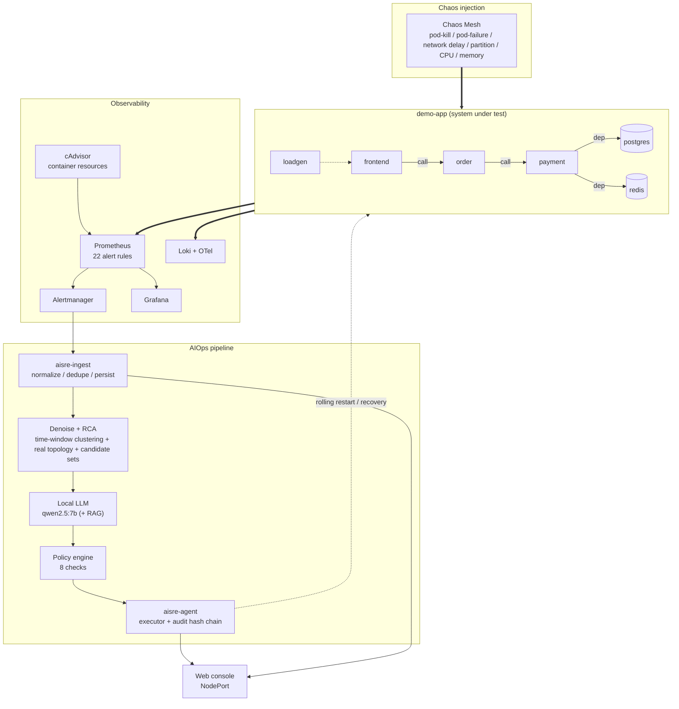

# AI SRE Agent · Cloud-Native Self-Healing & Chaos Verification Platform

[中文](README.md) | **English**

> The project covers **chaos injection, root-cause analysis, and self-healing execution**.
> It does not stop at installing components: **each stage has a measured result, and the results are cross-checked**.

[](https://kubernetes.io/)
[](https://chaos-mesh.org/)
[-8A2BE2)](https://ollama.com/)

---

## Contents

- [The problem this solves](#the-problem-this-solves)
- [Architecture](#architecture)
- [Measured results](#measured-results)
- [Design choices](#design-choices)
- [Quick start](#quick-start)
- [Repository layout](#repository-layout)
- [Documentation](#documentation)
- [About the "Silent Failure" post-mortems](#about-the-silent-failure-post-mortems)

---

## The problem this solves

In production, the expensive part of an incident is not "the service is down" — it is **the troubleshooting itself**:

| Pain point | What this project does |
|---|---|
| One incident fires dozens of alerts, each looking like a separate event | **Denoising**: collapses alerts into incident clusters, while guaranteeing that **two distinct faults are never merged into one** |
| On-call engineers guess the root cause from experience | **RCA**: four-way evidence weighting + local LLM structured reasoning + **topology folding** + hallucination checks |
| The LLM says something wrong and we just restart anyway — uncontrolled risk | **Guardrails**: 8 checks (action tiering / allowlist / cooldown / blast radius / idempotency / dry-run) |
| Nobody can tell who did what, and when | **Audit hash chain**: `hash = sha256(prev_hash + content)` — tampering is detectable |
| "The config is written" is treated as "it works" | A rule applied throughout: **configured ≠ effective, generated ≠ usable, running ≠ working** |

---

## Architecture



**Closed loop**: `inject fault → collect metrics/logs/alerts → denoise → LLM root-cause analysis → policy validation → automated execution → SLI recovery → audit trail`

---

## Measured results

### Fault matrix: 9 experiments, 26 evaluable runs, Top-1 hit 26/26 (100%)

| Exp | Fault type | Runs | Reduction | Purity | **Over-merge** | Cand. P/R | Top-1 |
|---|---|---|---|---|---|---|---|
| F01 | payment pod-kill | 2 (+1 no-alert) | 37.5%±37.5% | 100% | 0% | 1.00/1.00 | 2/2 |
| F02 | payment pod-failure | 3 | 63.7%±5.9% | 100% | 0% | 1.00/1.00 | 3/3 |
| F03 | order egress delay 800ms | 3 | 71.4%±0 | 100% | 0% | 1.00/1.00 | 3/3 |
| F04 | postgres CPU stress | 3 | 0% (only 1 alert) | 100% | 0% | 1.00/1.00 | 3/3 |
| F05 | payment network partition | 3 | 80.0%±0 | 100% | 0% | 1.00/1.00 | 3/3 |
| F06 | payment memory stress | 3 (+3 no-alert) | 50.0%±0 | 100% | 0% | 1.00/1.00 | 3/3 |
| F07 | payment partition (extended) | 3 | 92.3%±0 | 100% | 0% | 1.00/1.00 | 3/3 |
| **F13** | **cascading** (payment + order delay + redis) | 3 | 52.7%±11.3% | 82.8% | **0%** | 1.00/1.00 | 3/3 |
| **F14** | **multi-root** (payment + redis + postgres) | 3 | 75.4%±2.1% | 50.0% | **0%** | 1.00/1.00 | 3/3 |

> **F04's 0% reduction is not a failure**: it produced only **1** alert, and "one alert has nothing to reduce"
> — reduction rate must always be read together with the alert count.
> **F14's 50% purity is not a defect either**: in multi-root incidents a single cluster legitimately contains
> several candidates (`{payment, redis, postgres}` are all true root causes).
> For multi-root experiments, watch **over-merge rate (0% = independent faults were not merged)**
> and **candidate recall (1.00 = nothing was missed)**.

### Other measured metrics

| Capability | Measurement |
|---|---|
| **End-to-end self-healing loop** | injection → alert **112s**; execution → SLI recovery **210s**; 11 audit records, chain verified |
| **Two-tier LLM** | 0.6B pre-filter + 7B review → **6.9s** at 7B-level accuracy (7B alone: 35.7s) |
| **Anomaly detection** | three layers (threshold → MAD → EWMA) + debounce: 111 raw hits → 17 events |
| **Log template mining** | lightweight Drain implementation; ERROR ratio 0% → 4%/30%/93%, identifying request/downstream/dependency failures |
| **Local LLM** | qwen2.5:7b (Q4) + bge-m3 retrieval on an RTX 2070 8GB, fully offline |

---

## Design choices

### 1. Denoising reports a **set of metrics**, not a single number

Reporting "90% reduction" alone is dangerous: collapsing 20 alerts into 1 while picking the **wrong**
root cause is equivalent to **hiding the incident**. Every experiment therefore reports reduction rate,
cluster purity, **over-merge rate**, candidate precision/recall, Top-1 and MRR together.

### 2. A cluster's root cause is a **candidate set**, not a single answer

In cascading (F13) and parallel-dependency (F14) incidents, "one cluster → multiple true root causes" is
**correct**. Moving the evaluation from "guess the single answer" to "is the candidate set right" is what
matches the reality of coupled faults.

### 3. Local LLM + RAG, with an **honest negative result**

The project accumulated 50 real post-mortems and turned them into a vector knowledge base for RCA.
On the current matrix, however, **RAG provides no gain** (7/7 vs 7/7) — the structural fixes in the rule
layer and post-processing already saturate the pipeline. **That negative result is documented**, together
with what a harder benchmark would need to look like.

### 4. Guardrails and a tamper-evident audit trail

The LLM's output is **never executed directly** — it must pass 8 policy checks. Every action is appended
to a hash chain, so any modification of history is detectable.

### 5. 50 "Silent Failure" post-mortems

See the dedicated section below — this is the most distinctive part of the project.

---

## Quick start

### Prerequisites

- 5 Linux hosts (this project used openEuler 24.03: 1 control plane + 4 workers)
- A workstation (Windows/Linux) with an **NVIDIA GPU** for the local LLM (8 GB VRAM runs 7B Q4)
- Nodes must reach each other. **Note**: this project was built on a restricted network — images are moved
  by "pull on the workstation → transfer over LAN → `ctr import`"

### Steps

```bash
# 0) Put the root password in an environment variable (never in the repo)
export LAB_ROOT_PASSWORD='<your root password>'   # PowerShell: $env:LAB_ROOT_PASSWORD='...'

# 1) OS baseline + container runtime + cluster
bash scripts/01-baseline.sh            # all nodes
bash scripts/02-node-runtime.sh        # all nodes
bash scripts/03-init-cluster.sh        # control plane
bash scripts/04-join-cluster.sh        # workers
bash scripts/05-verify-cluster.sh      # control plane

# 2) Images (run on the workstation; bypasses blocked registries)
pwsh scripts/07-distribute-images.ps1

# 3) Observability + chaos + system under test
bash scripts/09-deploy-observability.sh
bash scripts/10-deploy-chaos-mesh.sh
bash scripts/11-deploy-demo-app.sh

# 4) AIOps pipeline
bash scripts/14-deploy-ingestion.sh    # alert ingestion
bash scripts/24-deploy-agent.sh        # self-healing executor
bash scripts/25-agent-selftest.sh      # 9 policy cases

# 5) Run a fault matrix and evaluate it
bash scripts/29-run-matrix.sh F02
bash scripts/30-eval-matrix.py --datasets datasets --topology topology/topology.json

# 6) End-to-end self-healing demo (~3-5 min)
bash scripts/28-selfheal-loop.sh --stage prepare --target payment --duration 90s
```

**Local LLM** (workstation):

```bash
ollama pull qwen2.5:7b && ollama pull bge-m3
python3 scripts/36-build-kb.py
python3 scripts/19-rca-llm.py datasets/<dataset> --topology topology/topology.json \
        --rag-kb kb/pitfalls-kb.jsonl --rag-top 2 --rag-excerpt 350
```

> Script numbers are also the execution/dependency order. 41 scripts in total.

---

## Repository layout

```
.
├── docs/                 # 12 documents (design / env / LLM / progress / post-mortems / matrix / demo / viz guide)
├── scripts/              # 41 scripts; the number is the execution order
├── manifests/            # K8s manifests (observability / chaos / app / AIOps components)
├── experiments/          # chaos experiment definitions (F01-F07, F13 cascading, F14 multi-root)
├── services/             # Go source: ingest (alert ingestion) / agent (self-healing executor)
├── topology/             # real service topology (collected by script 17)
├── datasets/             # dataset format spec (data itself is not committed)
└── kb/                   # RAG knowledge base (generated by script 36, not committed)
```

---

## Documentation

Read in numeric order; the numbering is the dependency order.

| # | Document | Content |
|---|---|---|
| 01 | [Technical design](docs/01-design.md) | architecture, modules, algorithms, evaluation, component internals |
| 02 | [Cluster access & host inventory](docs/02-cluster-access.md) | node specs, configuration record, deployment pitfalls |
| 03 | [Local LLM environment](docs/03-local-llm.md) | models that fit in 8 GB VRAM + inference configuration |
| 04 | [Progress log](docs/04-progress-log.md) | day-by-day progress, status, asset inventory, risks |
| 05 | [Project report](docs/05-project-report.md) | stage results, acceptance matrix, demo script |
| 06 | [**Silent failure post-mortems**](docs/06-pitfalls.md) | **50 problems that looked fine but were broken** |
| 08 | [Demo guide](docs/08-demo-guide.md) | end-to-end self-healing screen-recording script (with real timings) |
| 09 | [Fault matrix report](docs/09-matrix-report.md) | injection → observation → denoise/RCA, measured |
| 10 | [Visualization guide](docs/10-visualization-guide.md) | how to read the charts and what each experiment proves |
| — | [Docs index](docs/README.md) · [English index](docs/en/README.md) | full document and script index |

> Translations: see [docs/i18n.md](docs/i18n.md) for language status and conventions.

---

## About the "Silent Failure" post-mortems

**Definition**: no error, no crash, the process is running, `kubectl get pods` is all green — but the
functionality is **already broken**. And usually what broke is the most critical part (the metrics are
wrong, the alert never fired, the update never took effect).

This project has **50** such real records (`docs/06-pitfalls.md`), each with
**symptom / root cause / detection signal / fix / self-check command**. A few representative ones:

| ID | Problem | Why it matters |
|---|---|---|
| **P38** | "Cumulative of cumulative" in a downstream histogram | Bucket counts grew linearly and `+Inf` was *smaller* than the upper bucket → P95 turned 10 ms into 7.25 s. **It stayed wrong for two days because nothing consumed that metric** |
| **P39** | Changing a ConfigMap does not restart the process | The file inside the Pod was new; the process still ran two-day-old code |
| **P41** | Chaos injection failure was swallowed | `apply` failed, the error went to `/dev/null`, and the script still printed "injected" — **nearly shipping "no fault injected" as "monitoring blind spot"** |
| **P42** | NetworkChaos `target` vs ClusterIP | The controller reported `AllInjected=True` while the measured delay was 0.010 s (ineffective) vs 4.02 s without `target` |
| **P45** | Edge-scoped alerts carry no attribution | Denoising can only *guess* caller vs callee, and picked the wrong Top-1 |
| **P50** | Passing once ≠ reproducible | F06 produced **zero alerts in 3 consecutive runs** — only repetition could expose it |

> **Many of the 50 records were moments where the conclusion was one step away from being wrong.** They are worth keeping alongside the flows that worked.

---

## Reproducing and verifying

Every number in this project can be traced back to a dataset and a command:

| What to verify | How |
|---|---|
| Cluster health | `bash scripts/13-verify-e2e.sh` (10 groups, 25 checks) |
| Guardrails actually work | `bash scripts/25-agent-selftest.sh` (9 positive/negative cases) |
| Rules and denoising agree | `python3 scripts/33-check-rule-coverage.py` (with negative test) |
| Metrics satisfy their contract | `python3 scripts/34-check-metric-contracts.py` (monotonic buckets / `+Inf==count` / magnitude) |
| Reproducibility | `python3 scripts/35-summarize-repeats.py` (mean ± stddev) |
| Whether RAG helps | `python3 scripts/40-eval-rag-ab.py` (with/without RAG A/B) |

---

## License

[MIT](LICENSE)

---

> **Disclaimer**: this repository contains no real credentials. Scripts that need a password read it from
> the `LAB_ROOT_PASSWORD` environment variable. IPs in the docs (`172.29.20.x`) are an example private
> range — replace them with your own.
