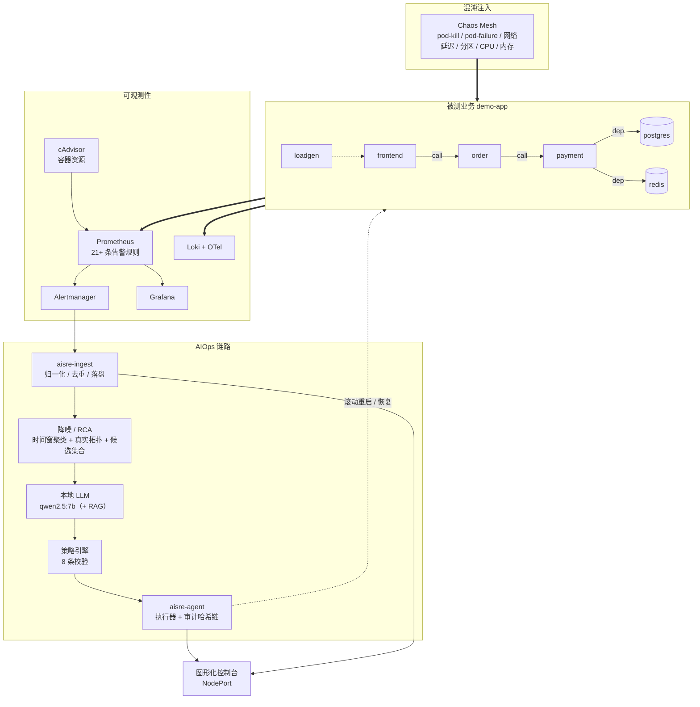

# AI SRE Agent · 云原生智能故障自愈与混沌验证平台

**中文** | [English](README.en.md)

> 一个**从混沌注入到自动根因分析再到自愈执行**的完整闭环项目 —— 重点不是"把组件装起来"，
> 而是**每一步都有实测数字，且数字经过交叉验证**。

[](https://kubernetes.io/)
[](https://chaos-mesh.org/)
[-8A2BE2)](https://ollama.com/)
[](docs/README.md)

---

## 目录

- [这个项目解决什么问题](#这个项目解决什么问题)
- [架构](#架构)
- [实测结果](#实测结果)
- [五个亮点](#五个亮点)
- [快速开始](#快速开始)
- [目录结构](#目录结构)
- [文档索引](#文档索引)
- [关于「沉默故障复盘」](#关于沉默故障复盘)

---

## 这个项目解决什么问题

线上故障最贵的不是"服务挂了"，而是**排障过程本身**：

| 痛点 | 本项目的做法 |
|---|---|
| 一次故障刷几十条告警，每条都像独立事件 | **降噪**：把告警收敛成事件簇，同时保证**不把不同故障揉成一个** |
| 值班人靠经验猜根因 | **RCA**：四路证据加权 + 本地 LLM 结构化推理 + **拓扑折叠** + 幻觉校验 |
| LLM 说错了就直接重启，风险不可控 | **安全护栏**：8 条策略校验（动作分级/白名单/冷却期/爆炸半径/幂等/干跑） |
| 谁在什么时候做了什么，事后查不清 | **审计哈希链**：每条动作 `hash = sha256(prev_hash + 内容)`，改动可检测 |
| "配置写了"就等于"生效了" | 全项目贯穿一条判据：**配置写了 ≠ 生效，文件生成了 ≠ 数据可用，进程起来了 ≠ 功能正常** |

---

## 架构



**闭环**：`注入故障 → 采集指标/日志/告警 → 降噪 → LLM 根因分析 → 策略校验 → 自动执行 → SLI 恢复 → 审计留痕`

---

## 实测结果

### 故障矩阵：9 个实验 · 26 轮可评测 · Top-1 命中 26/26（100%）

| 实验 | 故障类型 | 轮数 | 降噪率 | 簇纯度 | **过度合并** | 候选 P/R | Top-1 |
|---|---|---|---|---|---|---|---|
| F01 | payment pod-kill | 2 (+1 无告警) | 37.5%±37.5% | 100% | 0% | 1.00/1.00 | 2/2 |
| F02 | payment pod-failure | 3 | 63.7%±5.9% | 100% | 0% | 1.00/1.00 | 3/3 |
| F03 | order 出向延迟 800ms | 3 | 71.4%±0 | 100% | 0% | 1.00/1.00 | 3/3 |
| F04 | postgres CPU 压力 | 3 | 0%（仅 1 条告警） | 100% | 0% | 1.00/1.00 | 3/3 |
| F05 | payment 网络分区 | 3 | 80.0%±0 | 100% | 0% | 1.00/1.00 | 3/3 |
| F06 | payment 内存压力 | 3 (+3 无告警) | 50.0%±0 | 100% | 0% | 1.00/1.00 | 3/3 |
| F07 | payment 分区（加长） | 3 | 92.3%±0 | 100% | 0% | 1.00/1.00 | 3/3 |
| **F13** | **级联**（payment + order 延迟 + redis） | 3 | 52.7%±11.3% | 82.8% | **0%** | 1.00/1.00 | 3/3 |
| **F14** | **多根因**（payment + redis + postgres） | 3 | 75.4%±2.1% | 50.0% | **0%** | 1.00/1.00 | 3/3 |

> **F04 降噪率 0% 不是失败**：它只产生 1 条告警，「1 条无噪可降」—— **降噪率必须和告警条数一起看**。
> **F14 纯度 50% 也不是缺陷**：多根因场景下一个簇里本来就有多个候选（`{payment, redis, postgres}` 都是真根因）。
> 看多根因实验要盯 **过度合并率（0% = 没把独立故障揉一起）+ 候选召回率（1.00 = 一个都没漏）**。

### 其它实测指标

| 能力 | 实测 |
|---|---|
| **端到端自愈闭环** | 注入 → 告警 **112s**；执行 → SLI 恢复 **210s**；审计 11 条、链式校验 OK |
| **两级 LLM** | 0.6B 初筛 + 7B 复核 → **6.9s** 达到 7B 同等准确率（7B 单跑 35.7s） |
| **异常检测** | 三层（阈值 → MAD → EWMA）+ 去抖合并：111 条原始命中 → 17 个事件 |
| **日志模板挖掘** | 轻量 Drain 实现，ERROR 占比 0% → 4%/30%/93%，识别出请求失败/下游失败/依赖不可用 |
| **本地 LLM** | RTX 2070 8GB 上跑 qwen2.5:7b（Q4）+ bge-m3 检索，全离线 |

---

## 五个亮点

### 1. 降噪**不只报一个数**，而是一组互相制衡的指标

只报"降噪 90%"是危险的 —— 把 20 条告警收敛成 1 条、但根因判错，等于**把故障藏起来**。
所以每个实验都同时给出：降噪率、簇纯度、**过度合并率**、候选精确率/召回率、Top-1、MRR。

### 2. 一簇的根因是**候选集合**，不是唯一答案

级联故障（F13）和并列依赖故障（F14）里，"一个簇对应多个真根因"是**正确**的。
把评估口径从"猜唯一答案"改成"候选集合对不对"，才符合多故障耦合的现实。

### 3. 本地 LLM + RAG，且**如实报告负结果**

项目积累了 50 条真实踩坑记录，构建成向量知识库供 RCA 检索。
但在当前矩阵上 **RAG 没有增益**（7/7 vs 7/7）—— 因为规则层与后处理层的结构性修复已经把链路带到满分。
**这个负结果被如实记录**，并给出了"要验证 RAG 需要什么更难基准"。

### 4. 安全护栏 + 不可篡改审计

LLM 的输出**不直接执行**，必须过 8 条策略校验；每条动作写进哈希链，任何历史改动都能被检测出来。

### 5. 50 条「沉默故障复盘」

见下方专节 —— 这是本项目最有辨识度的部分。

---

## 快速开始

### 前置条件

- 5 台 Linux 主机（本项目用 openEuler 24.03，1 控制面 + 4 工作节点）
- 一台开发机（Windows/Linux 均可），**带 NVIDIA 显卡**用于本地 LLM（8GB 显存即可跑 7B Q4）
- 集群节点能互通；**注意**：本项目在受限网络下完成，镜像走"本机拉取 → 局域网传输 → `ctr import`"

### 步骤

```bash
# 0) 准备：把 root 密码放进环境变量（不写进仓库）
export LAB_ROOT_PASSWORD='<你的 root 密码>'      # PowerShell: $env:LAB_ROOT_PASSWORD='...'

# 1) 系统基线 + 容器运行时 + K8s 集群
bash scripts/01-baseline.sh            # 全部节点
bash scripts/02-node-runtime.sh        # 全部节点
bash scripts/03-init-cluster.sh        # 仅控制面
bash scripts/04-join-cluster.sh        # worker
bash scripts/05-verify-cluster.sh      # 仅控制面

# 2) 镜像（在开发机执行，绕开被墙的镜像源）
pwsh scripts/07-distribute-images.ps1

# 3) 可观测性 + 混沌 + 被测业务
bash scripts/09-deploy-observability.sh
bash scripts/10-deploy-chaos-mesh.sh
bash scripts/11-deploy-demo-app.sh

# 4) AIOps 链路
bash scripts/14-deploy-ingestion.sh    # 告警接入层
bash scripts/24-deploy-agent.sh        # 自愈执行层
bash scripts/25-agent-selftest.sh      # 9 项策略自检

# 5) 跑一次故障矩阵并评测
bash scripts/29-run-matrix.sh F02      # 单个实验
bash scripts/30-eval-matrix.py --datasets datasets --topology topology/topology.json

# 6) 端到端自愈闭环演示（3~5 分钟）
bash scripts/28-selfheal-loop.sh --stage prepare --target payment --duration 90s
# ...（详见 docs/08-demo-guide.md）
```

**本地 LLM**（开发机）：

```bash
ollama pull qwen2.5:7b && ollama pull bge-m3
python3 scripts/36-build-kb.py                                   # 构建 RAG 知识库
python3 scripts/19-rca-llm.py datasets/<数据集> --topology topology/topology.json \
        --rag-kb kb/pitfalls-kb.jsonl --rag-top 2 --rag-excerpt 350
```

> 脚本编号即**执行顺序 / 依赖顺序**，共 41 个。

---

## 目录结构

```
.
├── docs/                 # 10 篇文档（设计 / 环境 / LLM / 进展 / 复盘 / 矩阵 / 演示 / 可视化导读）
├── scripts/              # 41 个脚本，编号即执行顺序
├── manifests/            # K8s 清单（可观测性 / 混沌 / 业务 / AIOps 组件）
├── experiments/          # 混沌实验定义（F01–F07、F13 级联、F14 多根因）
├── services/             # Go 源码：ingest（告警接入）/ agent（自愈执行）
├── topology/             # 真实服务拓扑（由 17 号脚本采集）
├── datasets/             # 数据集格式说明（数据本身不入库，见 .gitignore）
└── kb/                   # RAG 知识库（由 36 号脚本生成，不入库）
```

---

## 文档索引

按编号顺序阅读，编号即依赖顺序。

| # | 文档 | 内容 |
|---|---|---|
| 01 | [技术设计](docs/01-design.md) | 架构、模块、算法、评测体系、排期、组件原理 |
| 02 | [集群访问与主机清单](docs/02-cluster-access.md) | 节点规格、配置记录、部署踩坑 |
| 03 | [本地大模型环境](docs/03-local-llm.md) | 8GB 显存上可跑的模型清单与推理配置 |
| 04 | [项目进展日志](docs/04-progress-log.md) | 逐日进度、状态总览、资产清单、风险与下一步 |
| 05 | [项目汇报](docs/05-project-report.md) | 阶段成果、验收对照、演示脚本 |
| 06 | [**沉默故障复盘**](docs/06-pitfalls.md) | **50 个「表面正常、实则失效」的问题** |
| 08 | [演示指南](docs/08-demo-guide.md) | 端到端自愈闭环录屏脚本（含实测时间线） |
| 09 | [故障矩阵报告](docs/09-matrix-report.md) | 注入 → 观测 → 降噪/RCA 的实测矩阵与根因 |
| 10 | [可视化导读](docs/10-visualization-guide.md) | 怎么用图表看懂实验目的 |
| — | [文档索引](docs/README.md) | 全部文档与脚本索引 |

---

## 关于「沉默故障复盘」

**"沉默故障"的定义**：不报错、不崩溃、进程在跑、`kubectl get pods` 全绿，但**功能已经失效** ——
而且往往失效的正是最关键的那部分（指标是错的、告警没发出、更新没生效）。

本项目积累了 **50 条**真实记录（`docs/06-pitfalls.md`），每条包含
**现象 / 根因 / 识别信号 / 修法 / 自查命令**。几条代表性的：

| 编号 | 问题 | 为什么值得看 |
|---|---|---|
| **P38** | 下游直方图的"累积的累积" | 桶计数线性递增、`+Inf` 反小于上界桶 → P95 把 10ms 算成 7.25s。**它错了两天没人发现，因为这个指标当时没有任何消费者** |
| **P39** | 改 ConfigMap 不重启进程 | Pod 里文件已是新的，跑的却还是两天前的旧代码 |
| **P41** | 混沌注入失败被"吞掉" | `apply` 返回错、错误丢进 `/dev/null`，脚本照样打印"已注入" —— **差一点把"没注入"当成"监控盲区"写进结论** |
| **P42** | NetworkChaos `target` 与 ClusterIP 不匹配 | 控制器报 `AllInjected=True`，实测延迟 0.010s（没生效）vs 去掉 target 后 4.02s |
| **P45** | 边类告警不带判责信息 | 降噪只能"猜是调用方还是被调方"，把 Top-1 判错 |
| **P50** | 单次跑通 ≠ 可复现 | F06 连跑 3 轮**全部零告警** —— 这个问题只有重复才能暴露 |

> 一句话：**发现的问题比跑通的流程更值钱。** 50 条里有相当一部分是"差一点得出反向结论"的时刻。

---

## 复现与验证

项目里的每个数字都能追到数据集与命令：

| 想验证什么 | 怎么做 |
|---|---|
| 集群健康 | `bash scripts/13-verify-e2e.sh`（10 组 25 项检查） |
| 策略护栏有效 | `bash scripts/25-agent-selftest.sh`（9 项正/反用例） |
| 规则与降噪是否对齐 | `python3 scripts/33-check-rule-coverage.py`（含负向验证） |
| 指标契约是否可信 | `python3 scripts/34-check-metric-contracts.py`（桶单调 / `+Inf==count` / 量级） |
| 重复性 | `python3 scripts/35-summarize-repeats.py`（均值 ± 标准差） |
| RAG 有没有用 | `python3 scripts/40-eval-rag-ab.py`（有无 RAG 对照） |

---

## 许可证

[MIT](LICENSE)

---

> **免责声明**：本仓库不含任何真实凭据。需要密码的脚本从环境变量 `LAB_ROOT_PASSWORD` 读取；
> 文档中的 IP（`172.29.20.x`）为示例私有网段，请按自己的环境替换。
