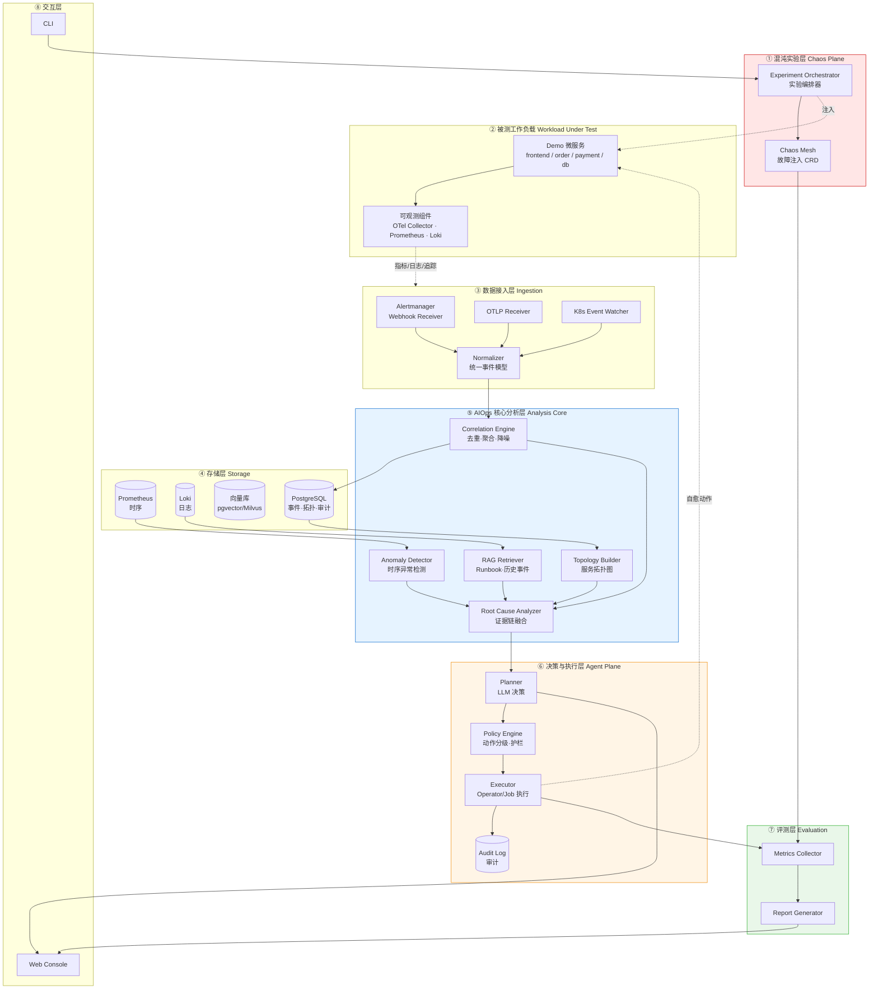
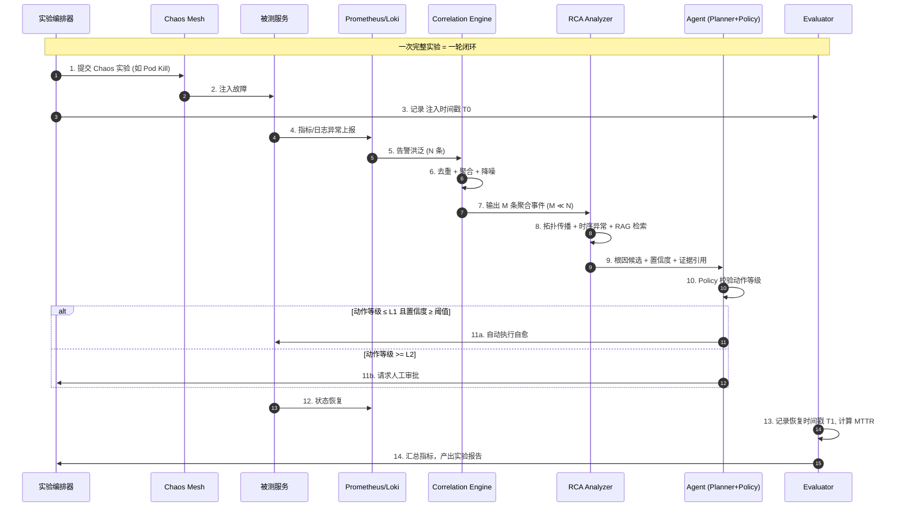
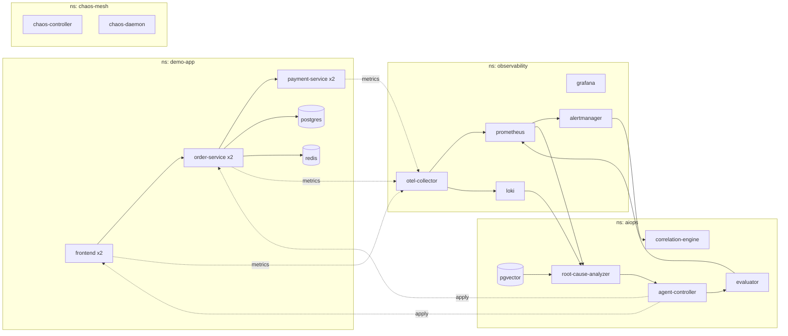
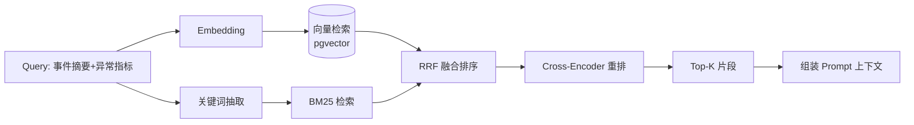
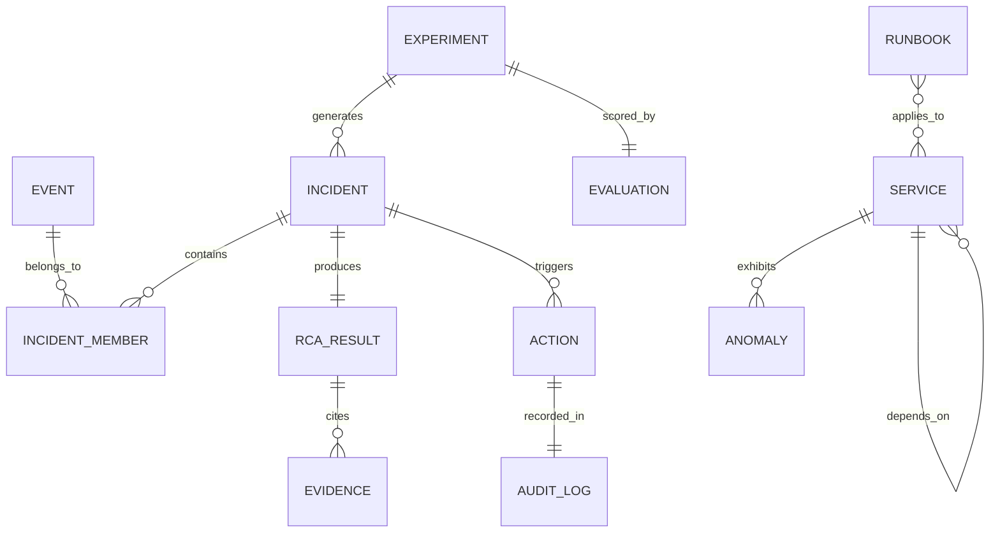
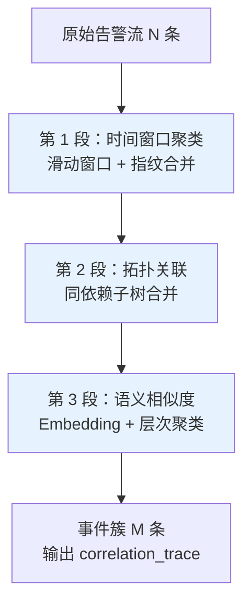
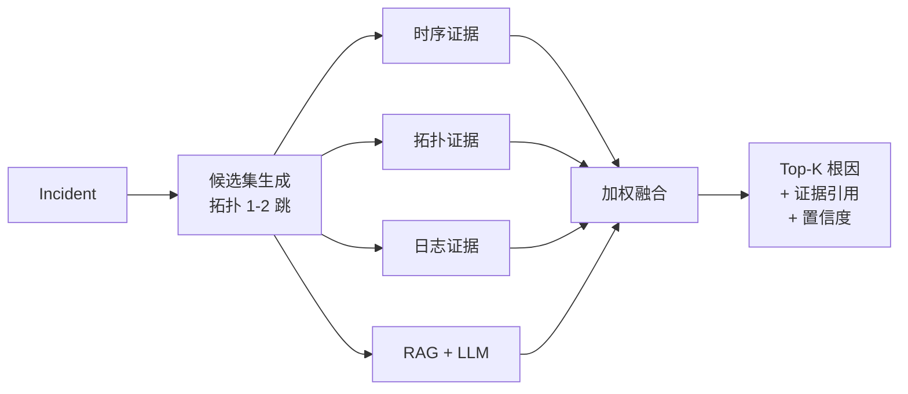
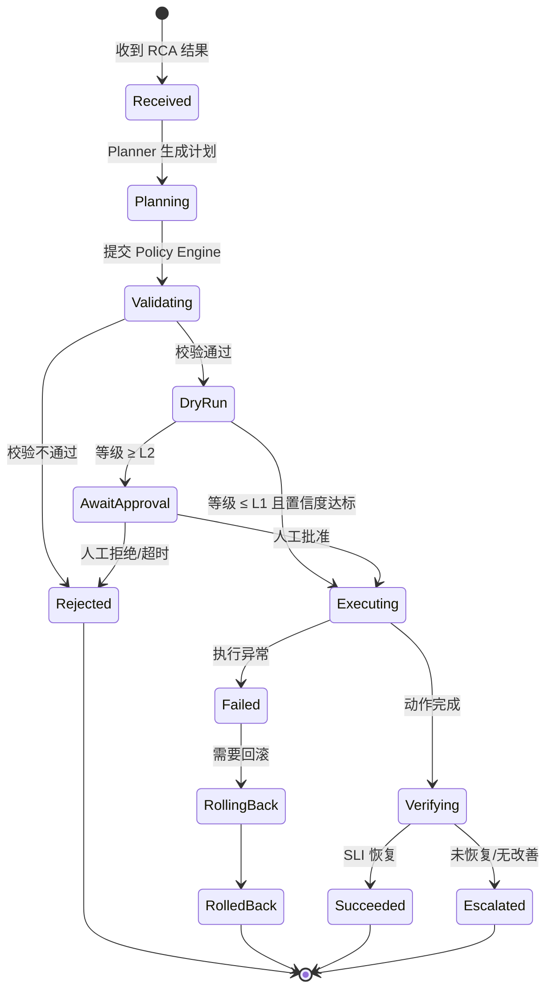
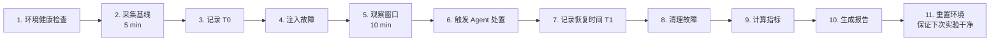

# AI SRE Agent —— 面向云原生环境的智能故障自愈与混沌验证平台

> **技术设计文档 · Technical Design Document**

| 项 | 内容 |
|---|---|
| 文档版本 | v1.0 |
| 创建日期 | 2026-10-28 |
| 项目代号 | AISRE-Agent |
| 读者对象 | 项目作者 / 开源贡献者 / 运维与平台工程师 |
| 关联方向 | SRE · AIOps · 云原生 · Kubernetes · LLM Agent |
| 关联文档 | [文档索引](README.md) · [02 集群访问与主机清单](02-cluster-access.md) · [03 本地大模型环境](03-local-llm.md) |

---

## 目录

1. [项目概述](#1-项目概述)
2. [术语表](#2-术语表)
3. [系统架构](#3-系统架构)
4. [模块设计](#4-模块设计)
5. [统一事件数据模型](#5-统一事件数据模型)
6. [告警降噪算法设计](#6-告警降噪算法设计)
7. [根因分析（RCA）设计](#7-根因分析rca设计)
8. [Agent 执行层与安全护栏](#8-agent-执行层与安全护栏)
9. [混沌工程实验设计](#9-混沌工程实验设计)
10. [评测体系](#10-评测体系)
11. [技术栈选型](#11-技术栈选型)
12. [接口定义](#12-接口定义)
13. [代码仓库结构](#13-代码仓库结构)
14. [开发排期（5 周逐日）](#14-开发排期5-周逐日)
15. [风险与缓解](#15-风险与缓解)
16. [里程碑与验收标准](#16-里程碑与验收标准)
17. [开源与内容计划](#17-开源与内容计划)
18. [附录](#18-附录)

---

## 1. 项目概述

### 1.1 项目定位

AISRE-Agent 是一个运行在 Kubernetes 上的 **AIOps 控制平面**：

> 将告警洪泛聚合成少量高置信度事件 → 用 **拓扑 + 时序 + 日志 + LLM** 四条证据链定位根因 → 在**分级安全护栏**下执行自愈动作 → 通过 **Chaos Mesh 故障注入**自动验证自愈效果并量化收益。

### 1.2 背景：为什么大多数 AIOps 项目失败

在动手前必须先承认这个领域的五个坑，本项目的架构就是围绕这五点设计的：

| 编号 | 常见失败模式 | 具体表现 | 本项目的对策 |
|---|---|---|---|
| P1 | 只有"发现"，没有"验证" | 系统说"我定位到了根因"，但没人知道准不准 | 混沌工程闭环：注入已知故障 → 验证定位是否正确 |
| P2 | 没有基线 | 无法证明 AI 比传统阈值告警更好 | 每项能力都做 **A/B 对照**（有 Agent vs 无 Agent） |
| P3 | LLM 幻觉 | 模型编造不存在的服务和指标 | 证据链约束 + 结构化输出 + 引用原文 |
| P4 | 没有安全边界 | 不敢让 AI 真的执行写操作，退化成"建议系统" | L0–L3 动作分级 + dry-run + 审批 + 回滚 |
| P5 | 没有评测 | 换个环境就失效，结论不可复现 | 内建评测集、指标定义、消融实验脚本 |

**P1 和 P5 是本项目的重点。** 不少 AIOps 项目只做到"输入告警、输出一段 LLM 生成的文字"，本项目还要给出可复现的实验结论。

### 1.3 设计目标（Goals）

| 编号 | 目标 | 验收方式 |
|---|---|---|
| G1 | **端到端闭环**：注入 → 采集 → 降噪 → RCA → 决策 → 执行 → 验证 → 报告 | 一条命令跑完全流程并产出报告 |
| G2 | **可量化**：每个环节都有明确定义的指标 | 见第 10 章，产出指标表格 |
| G3 | **可复现**：任何人能一键拉起环境并复现实验 | `make demo` / `make experiment` |
| G4 | **安全**：任何写操作都有 dry-run、审批与回滚 | 见 8.3 安全护栏清单 |
| G5 | **可插拔**：LLM、向量库、拓扑源、执行器均可替换 | 接口抽象 + 适配器模式 |

### 1.4 非目标（Non-Goals）

明确不做什么，避免范围失控：

- **N1** 不做通用监控系统 —— 复用 Prometheus / OpenTelemetry / Loki，不自研采集器（除少量自定义 exporter）
- **N2** 不做大模型训练或微调 —— 仅做推理侧集成与 Prompt/工作流工程
- **N3** 不做多云 CMDB —— 拓扑来源限定在 Kubernetes 与 OTel 可观测数据
- **N4** 不追求全自动无人值守 —— 明确采用 **Human-in-the-loop**（人工在环），高危动作必须审批
- **N5** 不做前端大屏 —— 用最小 CLI + 简单 Web 页面（Gradio/Streamlit）承载演示

### 1.5 设计特点

1. **闭环验证**：用 Chaos Mesh 注入已知故障，自动度量自愈前后的 MTTR 变化 —— 让 AIOps 的效果**可被证明**
2. **证据链融合 RCA**：拓扑传播 + 时序异常检测 + 日志模式 + LLM 推理四路证据加权，而非单一依赖大模型
3. **分级安全护栏**：L0 只读观测 → L1 幂等修复 → L2 有影响操作 → L3 高危操作，每级对应不同的审批与回滚策略
4. **内建评测体系**：降噪率、RCA Top-K 准确率、MTTR 改善率、误自愈率、Token 成本 —— 五项指标构成完整的评估矩阵

---

## 2. 术语表

| 术语 | 全称 | 说明 |
|---|---|---|
| SRE | Site Reliability Engineering | 站点可靠性工程 |
| AIOps | AI for IT Operations | 智能化运维 |
| RCA | Root Cause Analysis | 根因分析 |
| MTTD | Mean Time To Detect | 平均发现时间 |
| MTTR | Mean Time To Repair/Recover | 平均恢复时间 |
| MTBF | Mean Time Between Failures | 平均无故障时间 |
| RAG | Retrieval-Augmented Generation | 检索增强生成 |
| Chaos | Chaos Engineering | 混沌工程：主动注入故障以验证系统韧性 |
| SLI/SLO | Service Level Indicator / Objective | 服务等级指标 / 目标 |
| Blast Radius | — | 故障或操作的影响范围（爆炸半径） |
| Dedup | Deduplication | 告警去重 |
| Correlation | — | 告警关联/聚合 |
| Topology | — | 服务依赖拓扑图 |
| Guardrail | — | 安全护栏，限制 Agent 行为的边界 |
| Tool Calling | — | 大模型调用外部工具/函数的能力 |
| Reconcile | — | K8s Controller 的调谐循环，使实际状态逼近期望状态 |
| TTFT | Time To First Token | 大模型首 token 延迟 |

---

## 3. 系统架构

### 3.1 整体架构图



### 3.2 端到端数据流（核心闭环）



### 3.3 分层职责说明

| 层 | 职责 | 不该做的事 |
|---|---|---|
| ① 混沌实验层 | 按矩阵注入可控故障、记录实验元数据 | 不参与告警判定 |
| ② 被测工作负载 | 提供真实可观测的微服务与基础设施 | 不包含业务复杂度 |
| ③ 数据接入层 | 把异源数据规范化成统一事件模型 | 不做聚合与判断 |
| ④ 存储层 | 时序/日志/向量/关系数据持久化 | 不做计算 |
| ⑤ 分析核心层 | 降噪、拓扑、异常检测、根因分析、检索 | **不做任何写操作** |
| ⑥ 决策执行层 | LLM 规划、策略校验、执行动作、审计 | 不直接读原始告警 |
| ⑦ 评测层 | 指标采集、对照实验、报告生成 | 不参与在线决策 |
| ⑧ 交互层 | CLI / Web 控制台 | 不绕过 Policy 直接执行 |

> **关键设计原则：分析与执行严格分离。**
> 分析层永远只读；所有写操作必须穿过 Policy Engine。这条原则是安全护栏能够成立的前提。

### 3.4 部署拓扑（实验环境）



**资源需求**：单机 kind/k3s 集群，建议 8C16G 以上；Chaos Mesh 需要特权 DaemonSet。
**生产扩展**：Chaos Mesh 替换为 `PhysicalMachineChaos`；向量库从 pgvector 升级到 Milvus；Correlation Engine 按租户分片。

---

## 4. 模块设计

### 4.1 数据接入层（Ingestion & Normalization）

**职责**：把 Alertmanager Webhook、OTLP、K8s Event 三类异源数据转换为统一的 `Event` 模型，写入事件总线。

| 项 | 内容 |
|---|---|
| 输入 | Alertmanager Webhook (JSON) / OTLP gRPC-HTTP / K8s Watch Event |
| 输出 | `Event` 对象 → NATS JetStream / Kafka |
| 语言 | Go |
| 关键点 | 幂等去重（指纹）、时间戳归一化、标签规范化、背压控制 |

**事件指纹设计**（去重的第一道防线）：

```
fingerprint = sha256(
    source          +  // alertmanager | otel | k8s
    alertname       +  // 告警名
    namespace       +  // 命名空间
    workload        +  // 服务/工作负载名
    instance        +  // 实例标识（Pod/节点）
    severity           // 严重级别
)
```

- 指纹相同的告警在时间窗内合并为一条，计数存于 `occurrences`
- **不把时间戳纳入指纹**，否则永远无法去重

**失败模式与处理**：

| 失败模式 | 处理 |
|---|---|
| Alertmanager 重发（resolve 后 re-fire） | 靠指纹 + 状态机（firing/resolved）而非简单覆盖 |
| 时钟漂移 | 统一使用服务端接收时间 + 保留源时间戳两字段 |
| 流量突增 | 本地计数 + 周期性批量投递；超过阈值丢弃低优先级 |

---

### 4.2 告警关联与降噪引擎（Correlation Engine）

**职责**：把 N 条告警压缩成 M 条"事件簇"（incident），并输出簇的置信度与代表告警。

| 项 | 内容 |
|---|---|
| 输入 | 原始 `Event` 流 + 服务拓扑图 |
| 输出 | `Incident` 列表（含成员事件、时间范围、疑似根因服务） |
| 算法 | 三段式：时间窗口 → 拓扑关联 → 语义相似度（详见第 6 章） |
| 语言 | Python（离线模型）+ Go（在线聚合） |

**接口**：

```python
class CorrelationEngine:
    def ingest(self, event: Event) -> None: ...
    def flush(self, window_end: datetime) -> list[Incident]: ...
    def explain(self, incident_id: str) -> CorrelationTrace: ...
```

**`explain()` 是刻意设计的**：项目必须能回答"你凭什么把这两条告警聚到一起"。这个接口输出每一步的判定依据，既用于调试，也用于评测与论文式报告。

---

### 4.3 服务拓扑构建器（Topology Builder）

**职责**：自动构建服务依赖图，用于判断故障传播方向。

**三个拓扑来源（按可靠性排序）**：

| 来源 | 数据 | 优点 | 缺点 |
|---|---|---|---|
| OTel Trace | span 的 parent-child 关系 | 最准确、含调用方向 | 需要链路采样，可能不全 |
| K8s 编排关系 | Service / Endpoints / OwnerReference | 全覆盖 | 只反映静态关系 |
| 指标关联 | 指标共变分析 | 无侵入 | 噪声大，仅作补充 |

**输出**：有向图 `G = (V, E)`，`V` = 服务/工作负载/节点，`E` = 调用/依赖，边带权重（调用量、错误率）。

**存储**：PostgreSQL 邻接表 + 内存图（`networkx` / `gonum`）双写。

**关键点**：**拓扑必须有时间维度**。故障时刻的拓扑和 5 分钟前可能不同（如扩缩容），因此存快照版本号。

---

### 4.4 时序异常检测器（Anomaly Detector）

**职责**：对关键 SLI（错误率、延迟 P99、饱和度）做异常检测，为 RCA 提供时序证据。

**分层策略**（从简到繁，逐层增强）：

| 层级 | 方法 | 适用场景 | 复杂度 |
|---|---|---|---|
| L1 | 静态阈值 | 已知硬边界（如错误率 > 5%） | O(1) |
| L2 | 3-sigma / MAD | 平稳序列 | O(1) |
| L3 | EWMA + 同环比 | 有明显日周期 | O(1) |
| L4 | 季节性分解（STL） | 强周期性业务 | O(n) |
| L5 | Isolation Forest / 矩阵轮廓 | 多指标联合异常 | O(n log n) |

**强烈建议的工程约束**：**模型必须给出解释**。输出不是 `is_anomaly: true`，而是：

```json
{
  "metric": "http_request_error_rate",
  "service": "payment-service",
  "observed": 0.42,
  "expected_range": [0.01, 0.05],
  "deviation_score": 8.4,
  "method": "MAD",
  "window": "2026-10-28T10:00:00Z/2026-10-28T10:05:00Z"
}
```

> `expected_range` 和 `deviation_score` 是喂给 LLM 的关键上下文 —— 比单纯告诉它"异常了"信息量高一个量级。

---

### 4.5 根因分析器（RCA Analyzer）

**职责**：融合四路证据，输出带置信度和证据引用的根因候选列表。

**四路证据与权重**（权重可配置，用于消融实验）：

| 证据 | 来源 | 默认权重 | 物理含义 |
|---|---|---|---|
| E1 拓扑传播 | Topology Builder | 0.35 | 上游故障更可能是根因 |
| E2 时序首发 | Anomaly Detector | 0.25 | **最早异常**的服务更可能是根因 |
| E3 日志模式 | Loki + 模板挖掘 | 0.20 | 异常日志模式的归属服务 |
| E4 LLM 推理 | 大模型 + RAG | 0.20 | 语义层综合判断 |

**核心算法（简化伪代码）**：

```python
def analyze(incident: Incident) -> list[RootCauseCandidate]:
    # 1. 生成候选集：事件簇涉及的 + 拓扑上下游 1-2 跳的服务
    candidates = expand_by_topology(incident.services, hops=2)

    scores = {}
    for svc in candidates:
        e1 = topology_score(svc, incident)       # 上游 && 错误率异常 => 高分
        e2 = temporal_score(svc, incident)       # 首次异常时间越早 => 越高
        e3 = log_score(svc, incident)            # 异常日志模板集中度
        e4 = llm_score(svc, incident)            # LLM 结构化打分（0-1）
        scores[svc] = (
            0.35 * e1 + 0.25 * e2 + 0.20 * e3 + 0.20 * e4
        )

    return sorted_candidates(scores, top_k=5)
```

**输出契约（必须结构化）**：

```json
{
  "incident_id": "inc-20261028-0007",
  "root_causes": [
    {
      "rank": 1,
      "service": "payment-service",
      "confidence": 0.82,
      "hypothesis": "payment-service 因下游 DB 连接池耗尽导致错误率飙升",
      "evidence": [
        {"type": "temporal", "ref": "payment-service 错误率于 10:03:12 首发"},
        {"type": "topology", "ref": "order-service -> payment-service 调用错误率 41%"},
        {"type": "log", "ref": "loki://payment-service 出现 'connection pool exhausted' x128"},
        {"type": "knowledge", "ref": "runbook://db-connection-pool"}
      ],
      "suggested_actions": ["restart_pod", "increase_pool_size"]
    }
  ]
}
```

**幻觉抑制三原则**：
1. **候选集封闭**：LLM 只能从拓扑推导出的候选服务中选择，不能凭空造服务名
2. **证据强制引用**：每个结论必须绑定至少一条可追溯到原始数据的 ref
3. **后校验**：程序化校验 LLM 输出的服务名/指标名是否真实存在，不合法则丢弃该条

---

### 4.6 RAG 运维知识库（Retriever）

**职责**：为 RCA 和 Planner 提供可检索的运维知识（Runbook、历史事件、变更记录）。

**知识源**：

| 类型 | 内容 | 更新频率 |
|---|---|---|
| Runbook | 标准处置手册（Markdown） | 低 |
| 历史事件 | 过去的 incident + 根因 + 处置结果 | 高（自动写入） |
| 变更记录 | 发布、配置变更、扩缩容 | 高 |
| 架构文档 | 服务说明、依赖、SLO | 低 |

**检索管线（混合检索是关键）**：



- **必须做混合检索**（向量 + BM25）：纯向量检索对"错误码""组件名"这类精确 token 很不敏感，这在运维场景是致命的
- **Chunking 策略**：Runbook 按标题层级切分（保持"症状→诊断→处置"的语义完整），而不是固定长度切分
- **元数据过滤**：检索时按 `service`、`env` 过滤，避免检索到其他服务的处置方案

**离线评测**：构建"问题 → 应命中文档"标注集，用 Recall@K 和 MRR 评估检索质量。**这一步很多人跳过，但它决定了 RAG 的上限。**

---

### 4.7 Agent 决策层（Planner）

**职责**：基于 RCA 结果和检索到的知识，规划处置动作序列。

**实现方式**：LLM Tool Calling（ReAct 风格的有界循环）

**可用工具集（Tool Registry）**：

| 工具 | 等级 | 说明 |
|---|---|---|
| `query_metrics` | L0 | 查询 Prometheus 指标 |
| `query_logs` | L0 | 查询 Loki 日志 |
| `get_topology` | L0 | 获取服务依赖图 |
| `describe_workload` | L0 | 查看 Pod/Deployment 状态 |
| `restart_workload` | L1 | 重启工作负载（幂等） |
| `scale_workload` | L1 | 扩缩容 |
| `cordon_node` | L2 | 节点隔离（有影响） |
| `rollback_deployment` | L2 | 回滚发布 |
| `delete_pvc` | L3 | 高危，默认禁止 |

**有界循环设计（防死循环）**：
- 最大步数：`max_steps = 8`
- 最大工具调用次数：`max_tool_calls = 12`
- 单次实验 Token 预算上限
- 每步必须产出"进展"，连续两步无新信息则终止

**输出必须是可校验的结构体**，而非自然语言：

```json
{
  "plan_id": "plan-001",
  "steps": [
    {"action": "query_logs", "args": {"service": "payment-service", "since": "-5m"}, "level": "L0"},
    {"action": "restart_workload", "args": {"name": "payment-service"}, "level": "L1",
     "preconditions": ["no_active_deploy"], "rollback": "none_needed"}
  ],
  "rationale": "..."
}
```

---

### 4.8 策略与安全护栏（Policy Engine）

**职责**：在执行前校验每一个动作，是**唯一**能够授权写操作的地方。

**校验矩阵**：

| 检查项 | 规则 | 不通过时 |
|---|---|---|
| 等级校验 | `action.level <= max_auto_level` | 转人工审批 |
| 置信度 | `confidence >= 0.75`（可配） | 转人工审批 |
| 爆炸半径 | 受影响实例数 <= `max_blast_radius` | 降级 / 拒绝 |
| 冷却期 | 距上次同类动作 >= `cooldown` | 拒绝（防自愈风暴） |
| 幂等性 | 目标对象无进行中的同类操作 | 拒绝 |
| 时间窗口 | 不在变更冻结期 | 拒绝 |
| 白名单 | 目标在 `allowed_targets` 内 | 拒绝 |
| dry-run | 先模拟后执行 | 中止 |

**关键设计——冷却期（Cooldown）**：这是防止"自愈风暴"的核心机制。如果 Agent 反复重启同一个 Pod，说明它判断错了根因，此时**必须停止而非继续重试**。

```
if consecutive_actions(same_target, same_action) >= 3:
    escalate_to_human("疑似误判，已停止自动自愈")
```

---

### 4.9 执行器（Executor）

**职责**：实际执行被授权的动作，记录审计，支持回滚。

| 实现 | 说明 |
|---|---|
| K8s Operator / client-go | 原生动作（restart/scale/rollback） |
| Chaos Mesh CRD | 复用其成熟的故障控制能力（也可用于"注入式修复"验证） |
| Job Runner | 需要执行脚本的场景 |
| Ansible Runner | 面向信创/裸机环境的扩展接口（示例） |

**审计记录**：每一次执行都写入 `audit_log`，字段包括：谁触发（人/Agent）、依据哪个 incident、动作内容、执行结果、耗时、是否回滚。

> 审计日志是 SRE 场景的基本要求，用来回答"AI 系统做的事能不能追责"。

---

### 4.10 混沌实验编排器（Experiment Orchestrator）

**职责**：按实验矩阵注入故障、记录时间戳、驱动评测。

**接口**：

```yaml
# experiments/pod-kill.yaml
apiVersion: aiops.example.com/v1
kind: Experiment
metadata:
  name: exp-pod-kill-payment
spec:
  fault:
    type: PodChaos
    action: pod-kill
    target: {namespace: demo-app, labelSelector: {app: payment-service}}
    duration: 30s
    mode: one
  observe:
    window: 10m
    slis: [error_rate, p99_latency, throughput]
  evaluate:
    metrics: [mttr, dedup_ratio, rca_top1_accuracy, false_action_rate]
  safety:
    max_duration: 15m
    abort_on: {cluster_unhealthy: true}
```

**安全机制**：实验前检查集群健康度、实验后自动清理、超时强制中止。

---

### 4.11 评测器（Evaluator）

**职责**：采集指标、计算改善率、生成实验报告。**这是整个项目的"论文部分"。**

（指标定义详见第 10 章）

---

### 4.12 交互层（CLI & Web Console）

**CLI**（Go / Cobra）：

```bash
aiops experiment run --file experiments/pod-kill.yaml     # 跑一次实验
aiops experiment run --suite experiments/suite-basic.yaml # 跑整套矩阵
aiops incident list --since 1h                            # 查看事件
aiops incident explain inc-20261028-0007                  # 查看根因与证据链
aiops eval report --experiment exp-pod-kill-payment       # 生成报告
aiops policy sim --action restart --target payment-service # 模拟策略判定
```

**Web Console**：最小化 —— 事件时间线、拓扑图、根因证据链、实验对照报告。用 Gradio 或 Streamlit 快速交付，不追求美观。

---

## 5. 统一事件数据模型

### 5.1 核心实体



### 5.2 Event（统一事件）

```json
{
  "event_id": "evt-7f3a9c1e",
  "fingerprint": "sha256:9b2c...",
  "source": "alertmanager",
  "received_at": "2026-10-28T10:03:12.480Z",
  "occurred_at": "2026-10-28T10:03:10.000Z",
  "severity": "critical",
  "kind": "alert",
  "subject": {
    "service": "payment-service",
    "workload_kind": "Deployment",
    "namespace": "demo-app",
    "instance": "payment-service-6d9f7c-abc12",
    "node": "worker-2"
  },
  "signal": {
    "name": "HighErrorRate",
    "value": 0.42,
    "unit": "ratio",
    "threshold": 0.05
  },
  "labels": {"env": "staging", "team": "payment"},
  "raw": { "...": "原始 payload 保留，便于追溯" },
  "occurrences": 1,
  "status": "firing"
}
```

**设计要点**：
- `occurred_at` 与 `received_at` 分离 —— 用于计算**检测延迟 MTTD**
- `raw` 完整保留原始 payload —— 调试与审计必需，且向量化时可做二次提取
- `occurrences` 支持同指纹合并计数

### 5.3 Incident（事件簇）

```json
{
  "incident_id": "inc-20261028-0007",
  "experiment_id": "exp-pod-kill-payment-01",
  "started_at": "2026-10-28T10:03:10Z",
  "ended_at": "2026-10-28T10:05:40Z",
  "severity": "critical",
  "member_event_count": 137,
  "services": ["payment-service", "order-service", "frontend"],
  "suspect_root": "payment-service",
  "state": "resolved",
  "correlation_trace": {
    "time_window_clusters": 4,
    "topology_merges": 3,
    "semantic_merges": 1
  }
}
```

> 注意 `member_event_count: 137` 而最终只有 **1 个 incident** —— 这就是降噪率的来源，也是报告里最亮眼的数字。

### 5.4 RCA_RESULT / EVIDENCE / ACTION / AUDIT_LOG

```json
{
  "rca_result": {
    "incident_id": "inc-20261028-0007",
    "generated_at": "2026-10-28T10:04:05Z",
    "generation_latency_ms": 4200,
    "root_causes": [
      {
        "rank": 1,
        "service": "payment-service",
        "component": "db-connection-pool",
        "confidence": 0.82,
        "hypothesis": "连接池耗尽导致请求失败",
        "evidence": [
          {"type": "temporal", "weight": 0.25, "ref": "payment-service err_rate 首发 10:03:12"},
          {"type": "topology", "weight": 0.35, "ref": "order->payment err_rate=0.41"},
          {"type": "log", "weight": 0.20, "ref": "loki://.../pool_exhausted x128"},
          {"type": "knowledge", "weight": 0.20, "ref": "runbook://db-connection-pool"}
        ]
      }
    ],
    "ground_truth_match": true
  },
  "action": {
    "action_id": "act-001",
    "incident_id": "inc-20261028-0007",
    "tool": "restart_workload",
    "args": {"namespace": "demo-app", "name": "payment-service"},
    "level": "L1",
    "decision": "auto_approved",
    "policy_checks": [
      {"rule": "level_ok", "pass": true},
      {"rule": "confidence>=0.75", "pass": true, "value": 0.82},
      {"rule": "blast_radius", "pass": true, "value": 2},
      {"rule": "cooldown", "pass": true, "last_action_at": null}
    ],
    "started_at": "2026-10-28T10:04:12Z",
    "finished_at": "2026-10-28T10:04:38Z",
    "result": "success",
    "rollback_required": false
  }
}
```

**`policy_checks` 逐条落库是刻意设计**：展示时可以看清 Agent 的每个动作经过了哪 8 条校验、哪条不通过、为什么转人工。这类逐项证据在不少 AI Agent 项目中并不常见。

### 5.5 存储选型

| 数据 | 存储 | 理由 |
|---|---|---|
| Event 原始流 | NATS JetStream | 轻量、支持持久化与重放，单机可跑 |
| Incident / Action / Audit | PostgreSQL | 强一致，便于审计与关联查询 |
| 时序指标 | Prometheus | 复用生态，PromQL 通用 |
| 日志 | Loki | 与 Prometheus 标签体系一致 |
| 向量 | pgvector | **先用 pgvector 而非 Milvus** —— 降低部署复杂度，接口层做抽象，规模上来再换 |
| 拓扑快照 | PostgreSQL + 内存图 | 邻接表持久化，查询时载入内存 |

---

## 6. 告警降噪算法设计

### 6.1 问题定义

给定时间窗 W 内的告警集合 `A = {a1, a2, ..., aN}`，目标是划分为若干互不相交的簇 `C = {c1, c2, ..., cM}`，使得：

1. **同一故障引发的告警被聚到同一个簇**（完整性 / Recall）
2. **不同故障的告警不被错误合并**（纯度 / Precision）
3. **M << N**（降噪有效）

**这是个典型的"在召回和纯度之间做权衡"的问题。** 阈值调松 → 降噪率高但会误合并；调紧 → 纯度好但降噪率低。**这个权衡曲线本身就是你报告里的一张图。**

### 6.2 算法选型对比

| 方案 | 原理 | 优点 | 缺点 | 是否采用 |
|---|---|---|---|---|
| 静态规则（按标签分组） | 相同 service 归一组 | 简单、可解释 | 跨服务级联故障处理不了 | ✅ 作为基线 |
| 时间窗口聚类 | 窗口内告警归一组 | 简单、有效 | 窗口选择敏感，无法分因果 | ✅ 第 1 段 |
| 拓扑关联 | 同一依赖子树合并 | **能表达因果传播** | 依赖拓扑准确性 | ✅ 第 2 段 |
| 文本嵌入相似度 | 告警描述向量聚类 | 处理异构告警文本 | 对数字/错误码不敏感 | ✅ 第 3 段 |
| 图社区发现（Louvain） | 在告警关联图上分社区 | 无需预设簇数 | 超参多，解释性弱 | ⚪ 备选/对照 |
| 有监督分类 | 需要标注数据 | 上限高 | **冷启动无标注** | ❌ 不适用 |

> **有监督方案被明确排除**：AIOps 冷启动问题严重，没有历史标注数据时不可行。这也解释了为什么"纯机器学习方案"在企业落地困难 —— 这个洞察值得单独写一篇文章。

### 6.3 推荐方案：三段式流水线



**第 1 段 —— 时间窗口聚类**

```
1. 按 fingerprint 归并完全相同告警，计数 occurrences
2. 采用滑动窗口（非固定窗口），窗口大小 = 目标服务的 SLI 采集间隔 × k
3. 窗口内的告警依据 (service, severity) 归组
4. 输出：粗粒度簇

参数：window_size（默认 60s，可配 k=2..5）
```

**第 2 段 —— 拓扑关联（核心创新点）**

```
1. 对每个簇，取涉及的 service 集合 S
2. 在服务拓扑图上，计算 S 的最小连通子树
3. 若两簇的子树存在祖先-后代关系且时间上相近（Δt < τ）
   → 合并为一个 incident，根因候选指向祖先
4. 输出：拓扑关联后的簇

参数：Δt 阈值（默认 90s）、最大合并跳数（默认 2）
```

> **为什么这段重要**：级联故障中，数据库的 1 条告警会引发上层 200 条告警。纯时间窗口会把它们聚成一个"大杂烩"，而拓扑关联能明确指出"根因在下游"。

**第 3 段 —— 语义相似度**

```
1. 对告警文本（alertname + summary + 关键标签）做 embedding
2. 在同拓扑簇内做层次聚类（Agglomerative, cosine distance）
3. 合并相似度 > θ 的簇（默认 θ = 0.82）
4. 输出：最终 incident 集合 + correlation_trace
```

> 嵌入模型建议使用本地小模型（如 `bge-small-zh` / `m3e-base`），避免依赖云端 API。这样既能控制成本和延迟，也便于在离线环境验证。

### 6.4 参数与调优

| 参数 | 默认值 | 影响 | 调优方式 |
|---|---|---|---|
| `window_size` | 60s | 越大降噪率越高、纯度越低 | 网格搜索 + 画权衡曲线 |
| `topology_dt` | 90s | 决定跨服务合并的激进程度 | 基于实验数据 |
| `semantic_theta` | 0.82 | 语义合并阈值 | Precision-Recall 曲线 |
| `max_hops` | 2 | 拓扑传播深度 | 过多会引入噪声 |

**调优方法**：用混沌实验生成带 ground truth 的数据集（因为故障是**你主动注入的**，所以根因是已知的），然后做网格搜索。

> **这是自建数据集的最大优势。** 公开数据集（如 CCF AIOps 挑战赛）可以作为对照，但自注入数据能精确控制 ground truth，让评测结论更硬。

### 6.5 降噪评测

```
降噪率 (Reduction Ratio) = 1 - M/N
簇纯度 (Purity) = 同一 incident 内属于同一真实故障的告警数 / 该 incident 总告警数
簇完整性 (Completeness) = 被归入同一 incident 的同一故障告警数 / 该故障总告警数
```

**报告里必须同时给出三个指标。** 只报降噪率容易失真：把所有告警合成 1 条可以得到 99.9%，但结果没有分析价值。评价降噪效果时，需要把降噪率、簇纯度和过度合并率一起给出。

---

## 7. 根因分析（RCA）设计

### 7.1 总体思路

RCA 的本质是**从"现象"回到"原因"的因果推断问题**。纯 LLM 方案不可靠（幻觉 + 无法验证），纯规则方案覆盖不全。因此采用 **"规则生成候选，模型做排序"** 的混合架构：



**关键设计决策：LLM 不是决策者，而是证据提供者之一（权重 0.20）。**
这个定位同时约束了幻觉和不可执行两个问题，需要在设计中明确说明。

### 7.2 候选集生成（防止幻觉的第一道闸门）

```python
def generate_candidates(incident, topology, hops=2):
    seed = set(incident.services)
    # 向上游扩展（被依赖者更可能是根因）
    upstream = graph.ancestors(seed, max_hops=hops)
    # 同一节点的其他受影响服务
    siblings = graph.siblings(seed)
    candidates = seed | upstream | siblings
    # 过滤：时间窗口外无任何指标波动的服务直接排除
    return [c for c in candidates if has_signal_change(c, incident.window)]
```

> **LLM 后续只能从这个集合里选。** 如果 LLM 输出了一个不在候选集里的服务名，直接丢弃。这是最有效的幻觉抑制手段 —— 用**结构化约束**而不是靠 Prompt 祈求模型听话。

### 7.3 四路证据的量化

**E1 拓扑证据** —— 上游且异常更早 → 高分

```python
def topology_score(svc, incident):
    depth = graph.distance_to_roots(svc, incident.services)   # 越靠近祖先越优
    err_rate = metric(svc, "error_rate", incident.window)
    call_err = metric(svc, "upstream_call_error_rate", incident.window)
    return normalize(0.5 * (1 / (1 + depth)) + 0.5 * min(call_err / 0.1, 1.0))
```

**E2 时序证据** —— 首发时间越早越可疑

```python
def temporal_score(svc, incident):
    t_first = earliest_anomaly_time(svc, incident.window)
    if t_first is None:
        return 0.0
    delta = (t_first - incident.started_at).total_seconds()
    return exp(-max(delta, 0) / 60.0)      # 60s 衰减常数
```

> **"最早异常的服务更可能是根因"是一个需要被验证的假设，而不是真理。**
> 实验会暴露假设在哪些条件下不成立，例如根因服务有缓存或错误延迟暴露。**把反例写进文档，比只报告成功案例更可靠。**

**E3 日志证据** —— 异常日志模板的归属与集中度

```
1. 对窗口内该服务的日志做模板挖掘（Drain3）
2. 提取在基线期不存在、窗口内高频出现的模板
3. 得分 = 异常模板占比 × log(频次)
```

**E4 LLM + RAG 证据** —— 语义综合判断

```python
def llm_score(incident, candidates, retrieved_docs):
    prompt = build_rca_prompt(incident, candidates, retrieved_docs)
    resp = llm.chat(prompt, schema=RCA_SCHEMA)   # 强制 JSON Schema 输出
    return {c: resp.scores.get(c, 0.0) for c in candidates}
```

### 7.4 Prompt 设计要点（RCA）

```
【角色】你是资深 SRE，负责对线上故障做根因分析。

【任务】从下方【候选服务列表】中选出最可能的根因，给出置信度与证据。

【硬性约束】
1. 只能从候选服务列表中选择，不得引入任何未列出的服务或组件。
2. 每条结论必须引用至少一条【证据】中的原文或指标，格式："证据引用：<原文片段>"
3. 若证据不足以判断，必须输出 confidence < 0.5，并说明缺少什么信息。
4. 输出必须严格符合给定 JSON Schema，不要输出任何额外文字。

【候选服务列表】
{{candidates}}

【证据】
- 时序证据：{{temporal_evidence}}
- 拓扑证据：{{topology_evidence}}
- 日志证据：{{log_evidence}}
- 知识库检索结果：{{rag_docs}}

【输出 Schema】
{{schema}}
```

**Prompt 工程的三条经验**：
1. **约束要写进 Prompt 的"硬性"章节，并且在代码层再校验一遍** —— 双重保险
2. **要求模型输出"证据引用"能降低幻觉**，因为引用必须来自给定上下文
3. **允许输出"不知道"** —— 强制模型二选一会制造大量错误自信

### 7.5 RAG 设计细节

**Chunking 策略**（面向运维文档）：

```
Runbook 文档结构：
## 症状
## 影响范围
## 诊断步骤
## 处置方案
## 回滚方式

→ 按二级标题切分为 chunk，保留父标题作为元数据
→ 每个 chunk 前缀注入所属服务名（提升检索命中）
```

**检索融合（RRF）**：

```python
def hybrid_retrieve(query, k=10):
    vec_hits = vector_search(embed(query), top_k=30)
    kw_hits  = bm25_search(query, top_k=30)
    # Reciprocal Rank Fusion
    scores = {}
    for rank, doc in enumerate(vec_hits, 1):
        scores[doc.id] = scores.get(doc.id, 0) + 1 / (60 + rank)
    for rank, doc in enumerate(kw_hits, 1):
        scores[doc.id] = scores.get(doc.id, 0) + 1 / (60 + rank)
    return sorted_by_score(scores)[:k]
```

**重排**：用 cross-encoder（如 `bge-reranker-base`）对 Top-20 精排到 Top-5。

**检索质量评测**：构建 50-100 条"事件 → 应命中 runbook"的标注对，计算 **Recall@5** 和 **MRR**。这个数字直接决定 RCA 的 E4 证据质量。

### 7.6 RCA 评测指标

| 指标 | 定义 | 目标 |
|---|---|---|
| Top-1 Accuracy | 排名第一的候选就是真实根因的比例 | ≥ 60% |
| Top-3 Recall | 真实根因落在前三的比例 | ≥ 85% |
| MRR | 平均倒数排名 | ≥ 0.72 |
| 平均分析延迟 | 从 incident 生成到 RCA 输出的耗时 | ≤ 10s |
| 幻觉率 | 输出中无法追溯到证据的结论占比 | ≤ 5% |
| 无结论率 | 置信度 < 0.5 未给出明确结论的比例 | ≤ 20% |

> **无结论率需要单独报告。** 只报准确率会掩盖模型无法判断的情况；列出这个数字，读者才能看清可用范围。

---

## 8. Agent 执行层与安全护栏

### 8.1 动作分级（L0–L3）

| 等级 | 定义 | 示例 | 授权策略 | 回滚 |
|---|---|---|---|---|
| **L0** | 只读观测，零副作用 | 查指标、查日志、describe | 自动 | 不需要 |
| **L1** | 幂等修复，可安全重试 | 重启 Pod、扩容副本、清理驱逐 | 高置信度下自动 | 无需回滚 |
| **L2** | 有影响操作 | 节点隔离、发布回滚、配置变更 | **需要人工审批** | 必须提供回滚方案 |
| **L3** | 高危/不可逆 | 删除 PVC、删命名空间、改网络策略 | **默认禁止**，仅 dry-run | 不可回滚，禁止执行 |

**分级的目的**是限制自动化的影响范围。全部 L0 只能观察，全部 L3 风险过高；当前方案让 L1 自动执行，L2 必须审批。

### 8.2 执行状态机



### 8.3 安全护栏清单（Checklist）

**执行前**：

- [ ] 动作等级 ≤ `max_auto_level`（默认 L1）
- [ ] RCA 置信度 ≥ `min_confidence`（默认 0.75）
- [ ] 受影响实例数 ≤ `max_blast_radius`（默认 30%）
- [ ] 同类动作冷却期未触发（默认 5 分钟内不超过 3 次）
- [ ] 目标对象在当前 incident 的候选集内
- [ ] 目标在 `allowed_targets` 白名单内（如禁止操作 kube-system）
- [ ] 目标无进行中的同类操作（幂等）
- [ ] 当前不在变更冻结期
- [ ] dry-run 结果符合预期

**执行中**：

- [ ] 单次操作超时保护（默认 60s）
- [ ] 并发动作数量上限
- [ ] 实时监控 SLI，恶化则中止
- [ ] 全程写审计日志

**执行后**：

- [ ] 验证 SLI 是否恢复（观察窗默认 3 分钟）
- [ ] 未恢复 → 升级人工，**不自动重试第二次同类动作**
- [ ] 恢复 → 记录 MTTR 与处置路径
- [ ] 事后写入历史事件库（供 RAG 检索）

### 8.4 防止"自愈风暴"

```python
def should_execute(action, history) -> Decision:
    same = [h for h in history.recent(minutes=30)
            if h.tool == action.tool and h.target == action.target]
    if len(same) >= 3:
        return Decision.ESCALATE_HUMAN(
            reason="同一目标同类动作已执行 3 次仍未解决，疑似根因判断错误")
    if any(h.in_progress for h in same):
        return Decision.REJECT("已有进行中的同类操作")
    return Decision.ALLOW
```

> **执行安全是 Agent 设计的关键。** 一个会无限重试的自动化系统比没有自动化更危险；冷却期、爆炸半径、分级审批和审计链共同限制这类风险。

### 8.5 审计与可观测

| 事件 | 记录内容 |
|---|---|
| 计划生成 | 输入上下文摘要、模型版本、Token 消耗 |
| 策略校验 | 每条规则的通过/拒绝与原因 |
| 动作执行 | 触发源、目标、参数、耗时、结果 |
| 验证结果 | SLI 变化、是否恢复、最终归属 |
| 人工介入 | 审批人、时间、决策 |

**审计日志用 append-only 表 + 哈希链**（每条记录包含前一条的哈希），防止事后篡改，也便于追踪责任。

---

## 9. 混沌工程实验设计

### 9.1 故障注入矩阵

这是项目的主要数据来源。每一行都对应一次可控、可复现、ground truth 已知的实验。

| ID | 故障类型 | Chaos Mesh 资源 | 目标 | 预期现象 | 真实根因（Ground Truth） | 难度 |
|---|---|---|---|---|---|---|
| F01 | Pod 被杀 | `PodChaos/pod-kill` | payment-service | Pod 重建、短暂 5xx、错误率尖峰 | payment-service | ⭐ |
| F02 | 容器持续失败 | `PodChaos/container-kill` 周期 | order-service | CrashLoopBackOff、上游错误 | order-service | ⭐ |
| F03 | CPU 压力 | `StressChaos/cpu` | payment-service | P99 延迟上升、超时 | payment-service | ⭐⭐ |
| F04 | 内存压力 | `StressChaos/memory` | order-service | OOMKilled、重启 | order-service | ⭐⭐ |
| F05 | 网络延迟 | `NetworkChaos/delay` | payment→db | 请求超时、连接堆积 | payment-service 到下层的网络 | ⭐⭐ |
| F06 | 网络丢包 | `NetworkChaos/loss` | order→payment | 间歇性失败、重试风暴 | 网络链路 | ⭐⭐ |
| F07 | 网络分区 | `NetworkChaos/partition` | payment ↔ db | 完全不可用 | 网络分区 | ⭐⭐⭐ |
| F08 | DNS 故障 | `DNSChaos` | frontend | 域名解析失败 | DNS 记录 | ⭐⭐ |
| F09 | IO 延迟/错误 | `IOChaos` | postgres | 查询变慢、连接池耗尽 | 存储 IO | ⭐⭐⭐ |
| F10 | 时钟偏移 | `TimeChaos` | order-service | 证书校验失败、超时误判 | 时钟同步 | ⭐⭐⭐ |
| F11 | HTTP 故障注入 | `HTTPChaos` | 外部依赖 | 返回 500/延迟 | HTTP 层 | ⭐⭐ |
| F12 | 节点级故障 | `PodChaos` + cordon 模拟 | worker-2 | 多 Pod 同时异常、级联 | 节点 worker-2 | ⭐⭐⭐ |
| F13 | **级联故障** | F09 注入 db + 高负载 | 全链路 | 大量告警洪泛、多服务异常 | postgres | ⭐⭐⭐⭐ |
| F14 | **多故障并发** | F03 + F05 同时 | 两个服务 | 归因干扰（最难） | 双根因 | ⭐⭐⭐⭐ |

**F13 和 F14 用于补充单故障实验看不到的情况**：
- F13 验证级联故障下的降噪能力（一个根因可能引发 200+ 告警）。
- F14 验证多根因场景，检查系统是否会把两个独立故障错误合并。

> 单故障实验不足以覆盖多根因并发，F14 用来补上这部分。

### 9.2 实验标准流程



**第 11 步"重置环境"极其重要** —— 实验污染是最常见的坑。必须保证每次实验从相同的初始状态开始，否则数据不可比。

### 9.3 对照实验设计（A/B）

这是本项目"可证明有效"的关键。

| 组别 | 配置 | 用于回答 |
|---|---|---|
| **Baseline** | 只有静态阈值告警，无降噪、无 Agent | 传统方案有多差？ |
| **A: 只降噪** | 启用 Correlation Engine，无 RCA/Agent | 降噪本身带来多少收益？ |
| **B: 降噪 + RCA** | 启用 RCA，人工按建议处置 | RCA 定位准不准？ |
| **C: 全自动** | 完整闭环，L1 自动执行 | 自动化带来多少 MTTR 改善？ |

**每组跑 N ≥ 10 次**（同一个故障重复注入），取统计量（均值 + 标准差）。

> 只跑 1 次就下结论属于实验设计错误。每组跑 10 次并给出标准差和置信区间，结论才更可靠。

### 9.4 消融实验（Ablation）

对 RCA 的四路证据做消融，回答"每一路证据到底有没有用"：

| 实验 | 配置 | 预期结论 |
|---|---|---|
| Full | 四路证据全开 | 基准 |
| w/o E1 | 去掉拓扑权重 | Top-1 下降最明显 → 拓扑权重影响最大 |
| w/o E2 | 去掉时序权重 | 影响中等 |
| w/o E3 | 去掉日志权重 | 影响中等 |
| w/o E4 | 去掉 LLM 权重 | **关键：如果下降很小，说明 LLM 是"锦上添花"而非必需** |

> **`w/o E4` 的结果非常有价值，无论正负。**
> 如果去掉 LLM 后性能几乎不变，应写明"LLM 在此场景的边际收益有限，主要价值在于生成可读的解释"。这个结论比笼统声称 LLM 有效更可靠。

### 9.5 实验安全

- 单次实验最长 15 分钟，超时强制中止
- 实验前检查集群健康度，不健康则拒绝注入
- 实验限定在独立 namespace，禁止影响控制面（`kube-system`）
- 所有 Chaos 资源带 `chaos-mesh.org/cleanup` 标签，实验后强制清理
- 提供 `aiops chaos abort --all` 一键熔断

---

## 10. 评测体系

### 10.1 完整指标定义

| 类别 | 指标 | 定义 | 方向 | 目标 |
|---|---|---|---|---|
| **降噪** | 降噪率 | `1 - M/N`（M=事件簇数，N=原始告警数） | ↑ | ≥ 85% |
| | 簇纯度 | 同簇内同源告警占比 | ↑ | ≥ 90% |
| | 簇完整性 | 同源告警被同簇收录占比 | ↑ | ≥ 85% |
| **检测** | MTTD | T(首次告警) - T(故障注入) | ↓ | ≤ 30s |
| **RCA** | Top-1 准确率 | 首个候选即真实根因的比例 | ↑ | ≥ 60% |
| | Top-3 召回率 | 真实根因在前三的比例 | ↑ | ≥ 85% |
| | MRR | 平均倒数排名 | ↑ | ≥ 0.72 |
| | 幻觉率 | 无法追溯证据的结论占比 | ↓ | ≤ 5% |
| **自愈** | MTTR | T(SLI恢复) - T(故障注入) | ↓ | 相比 baseline 降低 ≥ 40% |
| | 自愈成功率 | 一次动作即恢复的比例 | ↑ | ≥ 70% |
| | **误自愈率** | 执行了动作但根因判断错误的比例 | ↓ | ≤ 10% |
| | 人工升级率 | 需要人工介入的比例 | ↓ | ≤ 30% |
| **成本** | 分析延迟 | incident → RCA 输出耗时 | ↓ | ≤ 10s |
| | Token 消耗 | 单次 incident 平均 Token 数 | ↓ | 记录即可 |
| | 单次实验成本 | 云端 GPU/算力成本 | ↓ | 记录即可 |

### 10.2 为什么"误自愈率"需要重点关注

大多数人只关心"恢复得快不快"。但 **一个误判根因、对错误目标执行自愈的系统，比不自动化的系统更危险。**

```
误自愈率 = 执行动作但根因判断错误 / 执行动作总数
```

**这个指标体现了可靠性优先于速度的取舍**，解读性能时需要同时考虑恢复成功率、误动作和恢复时间。

### 10.3 数据集构建

**三层数据集**：

| 层级 | 来源 | 规模 | 用途 |
|---|---|---|---|
| L1 自注入 | Chaos Mesh + 已知 ground truth | 14 类 × 10 次 = 140 次实验 | 主评测集 |
| L2 公开集 | CCF AIOps 挑战赛等公开数据集 | 视数据源 | 外部验证（可选） |
| L3 合成 | 基于真实数据做扰动增强 | 可扩展 | 边界情况测试 |

**L1 是主要评测集。** 故障由项目主动注入，根因已知，可以精确计算各项指标。

### 10.4 报告模板

每次实验输出一份 Markdown 报告：

```markdown
# 实验报告 exp-pod-kill-payment-01

## 实验配置
- 故障类型: PodChaos/pod-kill
- 目标: payment-service
- 对照组: Baseline / A / B / C

## 关键指标
| 指标 | Baseline | 本系统 | 改善 |
|---|---|---|---|
| 原始告警数 | 187 | 187 | — |
| 事件簇数 | 187 | 9 | — |
| 降噪率 | 0% | 95.2% | +95.2pp |
| MTTR | 412s | 168s | -59.2% |
| 根因定位 | 未提供 | 正确 (Top-1) | — |
| 误自愈 | — | 0 次 | — |

## 结论
在 Pod 被杀场景下，本系统将告警从 187 条压缩为 9 个事件簇，
根因定位正确，MTTR 相比基线降低 59.2%，无误自愈。

## 局限
- 单次实验，n=1（正式报告需 n≥10）
- 未覆盖多故障并发场景
```

> **主动写“局限”章节。** 公开技术文档也应明确项目边界和尚未验证的部分。

---

## 11. 技术栈选型

### 11.1 最终选型表

| 层次 | 选型 | 理由 | 备选 | 风险 |
|---|---|---|---|---|
| **编排/控制器** | **Go** + kubebuilder + controller-runtime | K8s 原生语言，SRE 岗位通用，**补足编码深度短板** | Python + kopf | Go 学习曲线，前 3 天会卡 |
| **AI/Agent 服务** | **Python** + FastAPI | 异步生态成熟，适合控制面原型 | Go | 无 |
| **Agent 框架** | 自研有界循环（参考 LangGraph 思想） | **自研比调框架更能展示理解**；框架黑盒难以解释 | LangGraph / LlamaIndex | 自研工作量略大 |
| **大模型** | 本地 Qwen 系列（vLLM 部署）+ 可选云端 API 兜底 | 本地部署便于离线验证，API 可作为对照 | 纯云端 API | 本地推理需显存 |
| **嵌入模型** | bge-small-zh / m3e-base（本地） | 成本低、延迟低、无外部依赖 | 云端 embedding | 中文效果需实测 |
| **向量库** | **pgvector** | 部署简单，与 PostgreSQL 共用实例；接口抽象便于升级 | Milvus / Qdrant | 千万级需迁移 |
| **关系存储** | PostgreSQL | 事务、审计、关联查询 | MySQL | 无 |
| **消息队列** | **NATS JetStream** | 单机轻量、支持持久化与重放 | Kafka | 生态小于 Kafka |
| **可观测** | OpenTelemetry + Prometheus + Loki + Grafana | 组件成熟，生态兼容性好 | — | 资源占用 |
| **链路** | OTel + Tempo（可选） | 拓扑来源 | Jaeger | 采样率权衡 |
| **混沌注入** | **Chaos Mesh** | CNCF 项目，CRD 化，覆盖最全 | Litmus / 自研 | 需特权容器 |
| **本地集群** | **kind** 或 k3s | 快、可重建 | minikube | 资源受限 |
| **日志模板挖掘** | Drain3 | 成熟、轻量 | 自研 | 中文日志需调参 |
| **前端** | Streamlit（首选） | 10 行代码起一个可用界面 | Gradio / React | 不美观 |
| **实验编排** | Python + Kubernetes Client | 灵活 | Argo Workflows | 无 |

### 11.2 语言分工（重要）

```
Go   ← K8s Operator、Ingestion、Executor、CLI     （占比 ~45%）
Python ← Correlation、RCA、RAG、Agent、Evaluator   （占比 ~45%）
YAML ← 部署清单、Chaos 实验、K8s CRD               （占比 ~10%）
```

**为什么选 Go**：Kubernetes、Prometheus 和 etcd 都主要使用 Go，client-go 与 controller-runtime 也围绕 Go 生态维护。项目先实现 Python 控制面，再用 Go 编写 Kubernetes Operator 和策略执行器，便于复用上游库。

> **这是一个刻意的技能补强设计，不是技术偏好。** 如果时间实在不够，可以先全部用 Python 跑通逻辑，再用 Go 重写核心控制器 —— 但要留出这部分时间。

### 11.3 资源需求

| 环境 | 配置 | 说明 |
|---|---|---|
| 开发机 | 4C8G | 只写代码，不跑集群 |
| 实验机（本地） | 8C16G + 50G 磁盘 | kind 集群 + 可观测栈（吃内存） |
| 含本地 LLM | 加 1×GPU（≥16G 显存）或租用云 GPU | 跑 Qwen 7B 级别 |
| 云上实验 | 按量 GPU 实例（用时开） | 控制成本 |

> **省钱建议**：本地 LLM 可以用小模型（Qwen2.5-1.5B/3B）验证流程，正式实验再上大模型。**不要让显存成为项目卡点。**

---

### 11.4 观测组件与混沌工程原理

> 本节说明「为什么需要这些组件」与「它们大致如何工作」，作为第 3–9 章设计的背景知识。

#### 11.4.1 为什么先装这两类组件

本项目的主链路是「发现故障 → 定位根因 → 自动修复 → 验证效果」。这条链路有两个前提：

- **可观测性是「感知器官」** —— 没有它，系统里发生了什么无从得知，只能靠人登机器看日志，机器一多就看不完，故障一过现场就消失
- **Chaos Mesh 是「故障发生器」** —— 没有它，无法验证根因定位与自动自愈到底准不准

两者缺一，AIOps 都无从谈起。

#### 11.4.2 三大支柱

| 支柱 | 回答什么问题 | 本项目选型 |
|---|---|---|
| Metrics 指标 | 「有没有变慢 / 变多？」（数值趋势） | Prometheus |
| Logs 日志 | 「具体报了什么错？」（文本事件） | Loki |
| Traces 链路 | 「请求卡在哪一跳？」（调用链） | OpenTelemetry（可选 Tempo） |

三者互补：**指标告诉你出问题了，日志告诉你什么问题，链路告诉你问题在哪一跳。** 只有指标定位不到根因，只有日志在量大时会淹死人。

#### 11.4.3 各组件工作要点

**Prometheus —— 指标采集与存储**

```
Prometheus ──每 15 秒──> 目标服务的 /metrics 端点
     ↑                          ↓
     └── 拉回数值 ────────> 本地时序数据库（TSDB）
```

关键点：**它是「拉」（pull）而不是「推」（push）**。每个被监控目标暴露 HTTP 端点，Prometheus 周期抓取。为什么用拉——目标挂了 Prometheus 立刻能发现（抓不到即异常），无需目标自己上报存活。

**Loki —— 日志聚合**

关键点：**只给标签建索引，日志正文不建索引**，压缩后直接存储。

这是它与 Elasticsearch 的核心差异：ES 给全文建倒排索引，查询快但吃资源；Loki 只索引 `namespace` / `pod` / `container` 等标签，**资源占用小一个数量级**。代价是按正文搜索较慢——但运维场景通常是「先按服务筛，再在结果里找关键字」，足够用。

**OpenTelemetry Collector —— 统一采集管道**

```
应用 ──OTLP──> Collector ──> 处理（批处理 / 过滤 / 脱敏）
                                ├──> Prometheus
                                ├──> Loki
                                └──> Tempo
```

关键点：它是**中间层**，让应用只对接一个标准协议，后端换存储不必改应用。这是它成为行业标准的原因。

**Grafana —— 可视化前端**

关键点：**它自己不存数据**，只是查询界面，把 Prometheus / Loki 当数据源。因此 Grafana 宕机不影响数据采集。

**Alertmanager —— 告警处理**

```
Prometheus 触发告警 ──> Alertmanager ──> 分组 / 去重 / 抑制 / 静默 ──> 通知渠道
```

关键点：Prometheus 只负责判断「是否超阈值」，Alertmanager 负责「要不要发、发给谁、发几条」。**没有它，一次故障会被同一原因触发几百条告警。**

> **本项目中的特殊角色**：Alertmanager 通过 webhook 将告警推送给自研 AIOps 系统，**这是整个项目的告警数据入口**（见 4.1 节）。

#### 11.4.4 Chaos Mesh 原理

**作用**：主动向系统中注入故障，观察系统是否扛得住。

逻辑是：**与其等故障在生产环境随机爆发，不如在受控环境主动制造它。**

**对本项目的两个用途**

| 用途 | 说明 |
|---|---|
| 验证韧性 | 测试服务的超时、重试、熔断、副本数配置是否合理（通用价值） |
| **提供 ground truth** | **本项目的关键**，见下方说明 |

```
一般 AIOps 项目的困境：
  拿到一批历史告警 → 分析出「根因是 A」 → 但无人知晓真实根因
  → 准确率无法计算 → 整个项目无法被验证

本项目的做法：
  主动注入故障（如「杀掉 payment-service 的 Pod」）
  → 真实根因 100% 已知
  → 所有指标（Top-1 准确率 / MTTR / 误自愈率）均可精确计算
```

**这就是第 1.5 节「让 AIOps 效果可被证明」的物质基础。**

**工作机制**

```
声明 CRD（如 PodChaos / NetworkChaos / StressChaos）
        ↓
chaos-controller-manager（控制组件，以 Pod 运行）
  监听 CRD，调度任务
        ↓
chaos-daemon（DaemonSet，每节点一个特权容器）
  在节点上执行实际动作
```

三个关键特性：

1. **声明式** —— 用 YAML 描述「要什么故障」，不需编写操作脚本。**故障因此可复现**：同样的 YAML，何时执行结果一致
2. **有明确时间边界** —— `duration: 30s` 到点自动恢复，不会因遗忘导致环境污染
3. **覆盖多种故障类型**，底层依赖 Linux 原生能力：

| 故障类型 | 底层机制 |
|---|---|
| Pod 被杀 | 调用 containerd API 终止容器 |
| CPU / 内存压力 | cgroup 限制 + 压测进程 |
| 网络延迟 / 丢包 | Linux `tc`（流量控制） |
| 网络分区 | `iptables` 规则 |
| DNS 故障 | 劫持 DNS 响应 |
| IO 延迟 | 文件系统层注入 |

> **chaos-daemon 需要特权容器** —— 因为它要操作节点的内核网络栈与 cgroup。这是它必须做成 DaemonSet 的原因。

#### 11.4.5 两类组件的咬合关系

```
① 混沌实验层     Chaos Mesh 注入已知故障
                       ↓
② 可观测性层     Prometheus 采指标 / Loki 采日志
                       ↓
③ 数据接入层     Alertmanager webhook 推送 ← 项目入口
                       ↓
④ 分析核心层     降噪 → 拓扑 → 时序异常 → RCA
                       ↓
⑤ 决策执行层     策略校验 → 执行自愈
                       ↓
⑥ 评测层         对比注入与恢复时间 → 计算 MTTR
```

**没有 ① ② 两层，③④⑤⑥ 就没有输入与验证手段。**

#### 11.4.6 部署清单与资源约束

| 命名空间 | 组件 | 说明 |
|---|---|---|
| `observability` | Prometheus | 指标采集与存储 |
| | node-exporter | 节点级指标（CPU / 内存 / 磁盘 / 网络） |
| | kube-state-metrics | K8s 对象指标（Pod 状态、重启次数等） |
| | Loki | 日志聚合存储 |
| | Grafana | 可视化（预配数据源与基础面板） |
| | Alertmanager | 告警处理 + webhook 出口 |
| | OTel Collector | 统一采集管道 |
| `chaos-mesh` | Chaos Mesh | controller + daemon + Dashboard |

**部署位置**：`observability` 全部落在 `k8s-obs`（15 GB 内存节点）；Chaos Mesh 的 daemon 以 DaemonSet 分布于全部 5 个节点。

**两个实际约束**：

1. **不使用 Helm** —— chart 仓库位于 GitHub，集群侧不可达。沿用 Flannel 的做法：**在开发机下载清单，本地化后随脚本分发**，不依赖外网
2. **必须控资源** —— Prometheus + Loki 同时运行会占用 6–8 GB。对策：
   - Prometheus 保留期设为 7 天（非默认 15 天）
   - Loki 采用单机 filesystem 模式，不做集群部署
   - 所有组件显式声明 `requests` / `limits`
   - 为命名空间设置 `ResourceQuota`

---
## 12. 接口定义

### 12.1 对外 REST API

```yaml
# 事件与事件簇
GET    /api/v1/events                  # 查询原始事件（支持时间/服务/严重级别过滤）
GET    /api/v1/incidents               # 查询事件簇
GET    /api/v1/incidents/{id}          # 事件簇详情
GET    /api/v1/incidents/{id}/explain  # 降噪决策追溯（correlation_trace）
GET    /api/v1/incidents/{id}/rca      # 根因分析结果与证据链

# 动作与策略
POST   /api/v1/actions/plan            # 生成处置计划（不执行）
POST   /api/v1/actions/simulate        # Policy 模拟判定（dry-run）
POST   /api/v1/actions/{id}/approve    # 人工审批（L2）
POST   /api/v1/actions/{id}/reject     # 人工拒绝
POST   /api/v1/actions/{id}/rollback   # 回滚

# 实验与评测
POST   /api/v1/experiments             # 提交实验
GET    /api/v1/experiments/{id}        # 实验状态
POST   /api/v1/experiments/{id}/abort  # 中止实验
GET    /api/v1/evaluations/{exp_id}    # 评测报告
GET    /api/v1/evaluations/summary     # 全量指标汇总

# 知识库
POST   /api/v1/knowledge/index         # 重建索引
GET    /api/v1/knowledge/search        # 检索测试（调试 RAG 用）

# 健康
GET    /healthz
GET    /metrics                        # Prometheus 格式
```

### 12.2 关键 CRD 定义

```yaml
# 自愈策略 CRD
apiVersion: aiops.example.com/v1
kind: RemediationPolicy
metadata:
  name: default-policy
spec:
  maxAutoLevel: L1                 # 自动执行最高等级
  minConfidence: 0.75
  cooldownSeconds: 300
  maxActionsPerTarget: 3
  maxBlastRadiusPercent: 30
  allowedNamespaces: ["demo-app"]
  deniedNamespaces: ["kube-system", "chaos-mesh"]
  freezeWindows:
    - cron: "0 2 * * 6"            # 每周六 02:00 变更冻结
  requireApprovalLevels: ["L2", "L3"]

---
# 动作审计 CRD（只读视图）
apiVersion: aiops.example.com/v1
kind: ActionRecord
metadata:
  name: act-20261028-001
spec:
  incidentRef: inc-20261028-0007
  tool: restart_workload
  level: L1
  decision: auto_approved
  policyChecks: [...]
  result: success
  startedAt: "2026-10-28T10:04:12Z"
  finishedAt: "2026-10-28T10:04:38Z"
  rollbackRequired: false
  auditHash: "sha256:..."
  prevAuditHash: "sha256:..."
```

### 12.3 Webhook 契约（Alertmanager → Ingestion）

```json
POST /webhook/alertmanager
Content-Type: application/json

{
  "version": "4",
  "status": "firing",
  "receiver": "aiops-ingest",
  "groupLabels": {"alertname": "HighErrorRate", "namespace": "demo-app"},
  "commonLabels": {"severity": "critical", "service": "payment-service"},
  "alerts": [
    {
      "status": "firing",
      "labels": {"alertname": "HighErrorRate", "service": "payment-service",
                 "instance": "payment-6d9f7c-abc12", "severity": "critical"},
      "annotations": {"summary": "错误率 42% 超过阈值 5%"},
      "startsAt": "2026-10-28T10:03:10Z",
      "fingerprint": "a1b2c3d4"
    }
  ]
}
```

**响应约定**：`200` 表示已接收（异步处理）；处理失败不返回 5xx，避免 Alertmanager 重试风暴，而是写入死信队列。

---

## 13. 代码仓库结构

```
ai-sre-agent/
├── README.md                     # 中英双语
├── README.en.md
├── LICENSE                       # Apache-2.0
├── Makefile                      # make demo / make experiment / make eval
├── docs/
│   ├── 01-design.md              # 本文档：技术设计
│   ├── 02-cluster-access.md      # 集群访问信息与主机清单
│   ├── 03-local-llm.md           # 本地大模型环境
│   ├── architecture.md           # 待补：架构详解
│   ├── evaluation.md             # 待补：实验报告汇总
│   └── images/
├── cmd/
│   ├── aiops/                    # CLI 入口
│   ├── controller/               # K8s Operator 入口
│   └── server/                   # API Server 入口
├── api/v1/                       # CRD 类型定义（Go）
│   ├── remediationpolicy_types.go
│   └── actionrecord_types.go
├── internal/
│   ├── ingest/                   # 数据接入 + 规范化
│   │   ├── alertmanager/
│   │   ├── otlp/
│   │   └── k8sevent/
│   ├── correlation/              # 告警降噪（Go 在线部分）
│   ├── topology/                 # 拓扑构建
│   ├── executor/                 # 动作执行
│   ├── policy/                   # 策略引擎
│   └── audit/                    # 审计（哈希链）
├── aiops/                        # Python 侧
│   ├── correlation/              # 降噪算法（离线/研究部分）
│   ├── rca/                      # 根因分析
│   ├── rag/                      # 检索增强
│   ├── agent/                    # Planner + 有界循环
│   ├── evaluator/                # 评测
│   └── models/                   # 异常检测模型
├── deploy/
│   ├── kind/                     # 本地集群
│   ├── helm/                     # Helm Chart
│   └── manifests/                # K8s 清单
├── experiments/                  # 混沌实验定义
│   ├── f01-pod-kill.yaml
│   ├── f13-cascading.yaml
│   └── suite-basic.yaml
├── datasets/                     # 评测数据集（含 ground truth）
│   └── README.md
├── runbooks/                     # 运维知识库（RAG 语料）
│   ├── db-connection-pool.md
│   └── pod-crashloop.md
├── demo/                         # 被测微服务
│   └── demo-app/
├── scripts/
│   ├── bootstrap.sh              # 一键拉起环境
│   ├── run-suite.sh              # 跑完整实验矩阵
│   └── gen-report.py             # 生成报告
├── tests/
│   ├── unit/
│   └── e2e/
└── .github/workflows/
    └── ci.yaml
```

**`datasets/` 目录要重点经营** —— 这是你独有的资产。里面放每次实验的原始数据 + ground truth + 指标计算结果。别人 clone 下来就能复现，这会让项目从"demo"变成"研究工具"。

---

## 14. 开发排期（5 周逐日）

### 排期假设

- **投入**：8 小时/天，每周 7 天（可留 1 天机动）
- **时间分配**：核心开发 5h / 理论阅读与源码 2h / 算法练习 1h
- **起止**：2026-11-02（周一）～ 2026-12-06（周日）
- **目标**：12 月第一周产出可演示的项目、完整实验数据和配套技术文章

> 每天安排 1 小时做代码与原理练习，重点保持实现、调试和问题定位能力。

### 第 1 周（11/02 - 11/08）：环境与数据打通

> **本周范围**：先让"注入故障 → 采集到数据"这条链路跑通，暂不编写 AI 分析代码。

| 日期 | 主线任务（5h） | 理论与源码（2h） | 算法（1h） |
|---|---|---|---|
| 11/02 一 | 安装 kind/k3s，起 K8s 集群；规划 4 个 namespace | 读 Chaos Mesh 架构文档 | 数组/哈希 |
| 11/03 二 | 部署 OTel Collector + Prometheus + Loki + Grafana | 读 Prometheus 抓取模型 | 双指针 |
| 11/04 三 | 部署 demo 微服务（frontend/order/payment + pg + redis） | 读 OTel 语义约定 | 滑动窗口 |
| 11/05 四 | 部署 Chaos Mesh，跑通第一个 PodChaos | 读 Chaos Mesh CRD | 二分查找 |
| 11/06 五 | 写 F01/F02 两个实验 YAML，验证注入生效 | 读 K8s Event 机制 | 链表 |
| 11/07 六 | 采集第一份原始数据（告警、指标、日志），落盘 | 读告警阈值设计实践 | 栈/队列 |
| 11/08 日 | **写 Day1-7 笔记**；环境重建脚本化（`bootstrap.sh`） | 复盘 | 周复习 |

**周末验收**：`bash scripts/bootstrap.sh` 能从零拉起完整环境；`aiops chaos run f01` 能注入故障并在 Grafana 看到异常曲线。

**常见卡点**：
- kind 集群内存不足 → 用 k3s 或加大 Docker 内存
- Chaos Mesh 需要特权容器 → Docker Desktop 需开启特权模式
- 中文日志采集乱码 → 统一 UTF-8

---

### 第 2 周（11/09 - 11/15）：降噪引擎（不接 LLM）

> **本周目标**：纯算法实现三段式降噪，**先建立基线**。

| 日期 | 主线任务（5h） | 理论与源码（2h） | 算法（1h） |
|---|---|---|---|
| 11/09 一 | Go：Ingestion 服务 + Alertmanager Webhook 接收 | 读告警洪泛成因 | 递归/回溯 |
| 11/10 二 | Go：事件指纹去重 + 统一 Event 模型 + NATS 投递 | 读 Alertmanager 分组机制 | 二叉树 |
| 11/11 三 | Python：第 1 段——时间窗口聚类 | 读聚类基础 | DFS/BFS |
| 11/12 四 | Python：Topology Builder（从 K8s Service/OTel 构建图） | 读图算法基础 | 图遍历 |
| 11/13 五 | Python：第 2 段——拓扑关联合并 | 读最小连通子树 | 并查集 |
| 11/14 六 | Python：第 3 段——Embedding 语义聚类 | 读文本嵌入原理 | 动态规划 |
| 11/15 日 | 跑通 F13 级联故障，产出第一份降噪率数据 | 复盘 + 写笔记 | 周复习 |

**周末验收**：F13 场景下，200+ 条告警 → 10 个以内事件簇，且簇纯度 ≥ 90%；输出 `correlation_trace`。

---

### 第 3 周（11/16 - 11/22）：异常检测 + RCA + RAG

> **本周目标**：从"有事件簇"升级到"能给出根因"。

| 日期 | 主线任务（5h） | 理论与源码（2h） | 算法（1h） |
|---|---|---|---|
| 11/16 一 | Python：时序异常检测（阈值→MAD→EWMA 三层） | 读异常检测方法 | 贪心 |
| 11/17 二 | Python：日志模板挖掘（Drain3）+ 异常模板提取 | 读日志模板挖掘 | 排序 |
| 11/18 三 | Python：候选集生成 + E1/E2/E3 证据打分 | 读因果推断基础 | 二分/前缀和 |
| 11/19 四 | Python：RAG 建库（pgvector + BM25 + RRF 融合） | 读混合检索与重排 | 堆/优先队列 |
| 11/20 五 | Python：LLM 接入（vLLM 本地部署或 API）+ 结构化输出 | 读结构化输出/JSON Schema | 单调栈 |
| 11/21 六 | 四路证据融合 + RCA 输出契约 + **幻觉后校验** | 读 Prompt 工程实践 | 字符串算法 |
| 11/22 日 | 跑 5 类故障，测 Top-1/Top-3 准确率 | 复盘 + 写笔记 | 周复习 |

**周末验收**：RCA Top-3 召回率 ≥ 70%，`explain` 接口能输出完整证据链，幻觉后校验生效。

---

### 第 4 周（11/23 - 11/29）：Agent 执行 + 安全护栏

> **本周目标**：从"给建议"升级到"敢执行"。

| 日期 | 主线任务（5h） | 理论与源码（2h） | 算法（1h） |
|---|---|---|---|
| 11/23 一 | Go：CRD 定义（RemediationPolicy / ActionRecord） | 读 kubebuilder 入门 | 位运算 |
| 11/24 二 | Go：Controller 骨架 + informer + reconcile 循环 | **读 controller-runtime 源码** | 设计题 |
| 11/25 三 | Python：Planner（有界循环 + Tool Registry + 结构化计划） | 读 Agent 设计模式 | 前缀树 |
| 11/26 四 | Go：Policy Engine（8 条校验规则 + 冷却期） | 读幂等与重试设计 | 线段树 |
| 11/27 五 | Go：Executor（重启/扩容/回滚）+ 审计哈希链 | 读 K8s 客户端最佳实践 | 树状数组 |
| 11/28 六 | Go：ActionRecord 状态机 + 验证（SLI 恢复判定） | 读 SLO 与错误预算 | 拓扑排序 |
| 11/29 日 | 跑通一次完整自动自愈闭环 | 复盘 + 写笔记 | 周复习 |

**周末验收**：漏洞注入 → 自动检测 → 自动重启 → SLI 恢复 → 审计可查，全链路无需人工。`policy sim` 能展示逐条校验结果。

---

### 第 5 周（11/30 - 12/06）：实验矩阵 + 评测 + 文档

> **本周目标**：产出可复现的结论和可展示的成果，并补齐复现步骤。

| 日期 | 主线任务（5h） | 理论与源码（2h） | 算法（1h） |
|---|---|---|---|
| 11/30 一 | 补齐 14 类故障实验定义（含 F14 多故障并发） | 读实验设计方法 | 综合复习 |
| 12/01 二 | Evaluator：指标计算 + A/B 对照 + 消融实验脚本 | 读统计显著性基础 | 综合复习 |
| 12/02 三 | 跑完整实验矩阵（每类 n≥5），采集数据 | 读报告写作 | 综合复习 |
| 12/03 四 | 出图：降噪率曲线、MTTR 对比、指标汇总表 | — | 综合复习 |
| 12/04 五 | 写 README（中英）、架构图、`make demo` 一键复现 | 读优秀开源 README | 综合复习 |
| 12/05 六 | 录演示视频（3-5 分钟：注入→自愈→报告） | — | 综合复习 |
| 12/06 日 | 发布 GitHub 和 CSDN 第 1-2 篇；整理项目 FAQ | 复盘全项目 | 综合复习 |

**周末验收**：GitHub 仓库公开、`make demo` 可复现、实验报告有完整数字、演示视频可播放。

---

### 12/07 起：维护与补充验证

- 每日 2h 维护项目：补测试、回应 issue、补文档
- 每日 2h 复核实验：重跑关键场景，检查结论是否可复现
- 每日 4h 补充未覆盖故障类型与代码实现
- **项目代码继续提交**：每次提交对应一个问题或一轮验证结果

---

## 15. 风险与缓解

| 风险 | 概率 | 影响 | 缓解措施 |
|---|---|---|---|
| **范围失控**（想做完整平台） | 高 | 高 | 坚持"一条链路端到端优先"；每周按验收项控制范围 |
| **Go 学习曲线** | 中 | 中 | 第 1 周先只写最小控制器；实在卡住 → 先用 Python 跑通再重写 |
| **本地显存不足** | 中 | 中 | 先用 1.5B/3B 小模型验证流程；正式实验用云 GPU 或 API |
| **Chaos Mesh 环境问题** | 中 | 中 | kind 需特权容器；提前在 Day1 验证，不要拖到第 4 周 |
| **实验污染**（环境不干净） | 高 | 高 | 每次实验后强制重建环境；`bootstrap.sh` 幂等 |
| **数据量不够** | 中 | 中 | 每类故障 n≥5，不足则用合成数据增强 |
| **实验结论不理想** | 中 | 低 | **如实报告**。结论为负也是有价值的发现，写进"局限" |
| **Token 成本超支** | 低 | 低 | 本地模型 + 预算上限 + 缓存 |
| **只有 demo 没有深度** | 中 | 高 | 强制要求：每个模块必须有"为什么这么设计"的文档段落 |

**主要风险是范围失控。** 如果每天投入较多时间，容易把项目扩成完整平台，最后卡在单个模块。每周按验收项检查，不达标时优先缩减范围，不用延期掩盖进度。

---

## 16. 里程碑与验收标准

| 里程碑 | 日期 | 验收标准（必须全部满足） |
|---|---|---|
| M1 环境就绪 | 11/08 | 一键脚本拉起环境；能注入故障并采集数据 |
| M2 降噪可用 | 11/15 | 级联故障下降噪率 ≥ 85%，纯度 ≥ 90%，可解释 |
| M3 RCA 可用 | 11/22 | Top-3 召回 ≥ 70%，证据链完整，有幻觉后校验 |
| M4 闭环打通 | 11/29 | 注入→检测→自愈→验证全自动，审计可查 |
| M5 可展示 | 12/06 | GitHub 公开 + 实验报告 + 演示视频 + `make demo` |
| M6 对外发布 | 12/07 | 项目摘要 + 项目 FAQ + CSDN 首篇发布 |

---

## 17. 开源与内容计划

### 17.1 开源发布要点

1. **README 第一屏放架构图、项目用途和已核验的关键数字**
2. **提供屏幕录制或 GIF**，展示从故障注入到自动恢复的过程
3. **提供 `make demo`**，降低复现门槛
4. **`docs/evaluation.md` 放完整实验数据**，便于读者复核结论
5. **持续提交**：每 1-2 天提交一次有明确内容的变更，不要最后一次性上传
6. **License 用 Apache-2.0**，加 `CONTRIBUTING.md` 和 `Good First Issue` 标签
7. **GitHub Actions CI**：至少运行 lint 和单元测试

### 17.2 技术文章规划

| # | 标题 | 解决的问题 |
|---|---|---|
| 1 | 为什么 AIOps 项目容易停留在演示阶段？—— 从评测缺失说起 | 如何判断 AIOps 是否真的有效 |
| 2 | 告警降噪实战：时间窗口 + 拓扑关联 + 语义聚类的三段式设计 | 如何降低告警风暴带来的噪声 |
| 3 | 让大模型做根因分析：幻觉抑制的四道闸门 | 如何约束 LLM 幻觉 |
| 4 | 运维 RAG 为什么需要混合检索？纯向量检索的局限 | 如何设计可追溯的运维检索 |
| 5 | Agent 如何安全执行运维动作？—— L0-L3 分级与安全护栏 | 如何限定自动化安全边界 |
| 6 | 用 Chaos Mesh 构建 AIOps 的自动验证闭环 | 如何验证算法是否有效 |
| 7 | 如何量化 AIOps 效果：五个指标与消融实验 | 如何度量效果 |
| 8 | 用 Go 写 Kubernetes Operator：从 CRD 到 reconcile | 如何扩展 Kubernetes 控制面 |

**发布节奏**：从第 3 周开始每周 1-2 篇，不要全堆到项目结束后。

### 17.3 项目摘要

公开仓库和文章中的数字应以当前可复现实验为准。下面是一份与当前实验结果一致的摘要，可直接放进 README、技术文章或项目介绍：

> **AI SRE Agent** 是一个面向 Kubernetes 的故障自愈与混沌验证平台。
> - 使用时间窗口、拓扑关联和语义聚类完成告警降噪，并对候选根因集合计算精确率、召回率和 Top-1 命中率。
> - 在 9 类故障、26 轮可评测实验里，候选精确率和召回率均为 1.00，Top-1 命中 26/26，过度合并率为 0。
> - 将 LLM RCA 的输出限制在候选集合内，要求引用时序、拓扑或日志证据，并对结果做程序化校验。
> - 执行层包含动作分级、冷却期、爆炸半径、dry-run 和审计链；Chaos Mesh 用于生成带 ground truth 的故障样本。
>
> 各实验的降噪率差异较大，需要和告警条数一起阅读。例如 F04 只有 1 条告警，降噪率自然是 0。

---

## 18. 附录

### 18.1 参考资料

**混沌工程**
- Chaos Mesh 官方文档与 CRD 参考
- 《混沌工程》（Principles of Chaos Engineering）—— 混沌工程四原则
- Netflix Chaos Monkey 设计思想

**AIOps / 根因分析**
- CCF AIOps 挑战赛公开数据集与赛题思路
- 微服务根因分析相关论文（服务依赖图 + 时序异常方向）
- 《Site Reliability Engineering》（Google SRE 三部曲）

**云原生**
- Kubernetes controller-runtime / kubebuilder 官方文档
- OpenTelemetry 语义约定（Semantic Conventions）
- Prometheus 告警与记录规则最佳实践

**RAG 与 Agent**
- RAG 混合检索与重排序工程实践
- 结构化输出 / JSON Schema 约束解码

### 18.2 项目常见技术问题

1. 这个项目解决了什么问题？简要说明：让 AIOps 的效果可以被验证。
2. 为什么用三段式降噪，而不是端到端模型？冷启动阶段缺少标注数据，可解释性也更重要。
3. LLM 在系统里承担什么角色？为什么只给 0.20 权重？
4. 如何防止 LLM 幻觉？候选集封闭、证据强制引用、程序化校验、允许弃权。
5. Agent 会不会引入故障？冷却期、爆炸半径、分级审批和审计哈希链共同限制风险。
6. 如何证明系统有效？使用 A/B 对照、消融实验、五个指标和统计量。
7. 消融实验里 LLM 的边际收益如何？结论需要包含负面结果，不能只保留有利数据。
8. 项目有哪些局限？当前是单机环境，故障类型有限，尚未做大规模验证，也没有真实业务流量。

> **第 8 题是项目边界说明。** 明确写出未验证部分，比夸大适用范围更可靠。

### 18.3 变更记录

| 版本 | 日期 | 修改内容 | 作者 |
|---|---|---|---|
| v1.0 | 2026-10-28 | 初稿：完整技术设计与 5 周排期 | — |
| v1.1 | 2026-10-31 | 文档编号为 **01**；补充关联文档索引；同步仓库结构目录树 | — |
| v1.2 | 2026-10-31 | 新增 §11.4「观测组件与混沌工程原理」：三大支柱、各组件工作机制、Chaos Mesh 原理与 ground truth 价值；同步关联文档索引 | — |

---

> **执行说明**：这份文档按步骤落地比通读更重要。
> 每周按验收项检查；不达标时优先缩减范围，不用延期掩盖问题。
